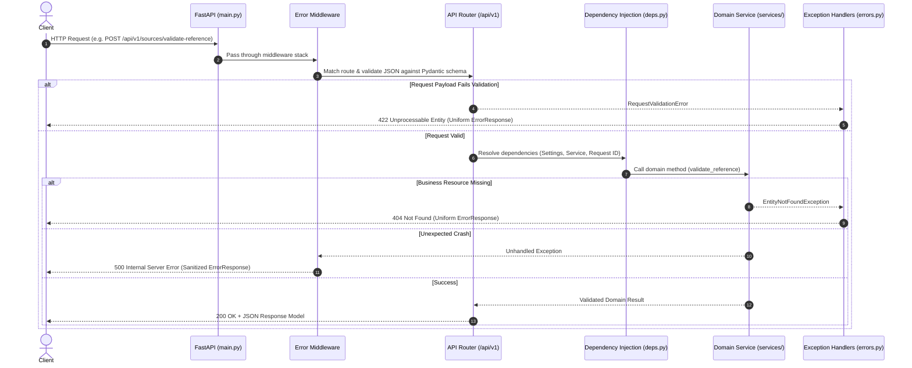
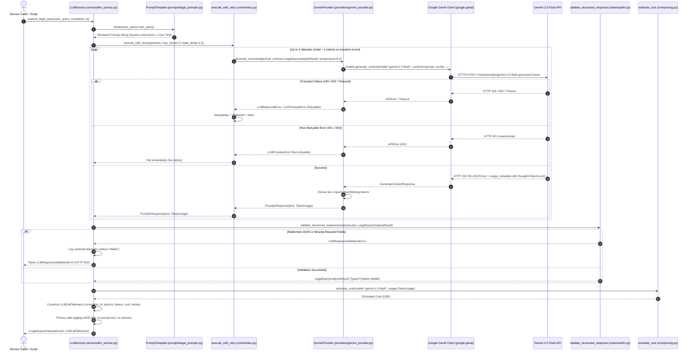
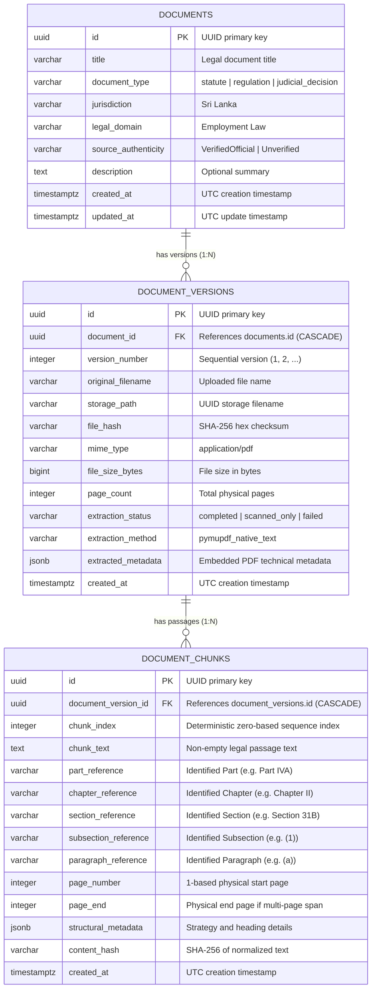
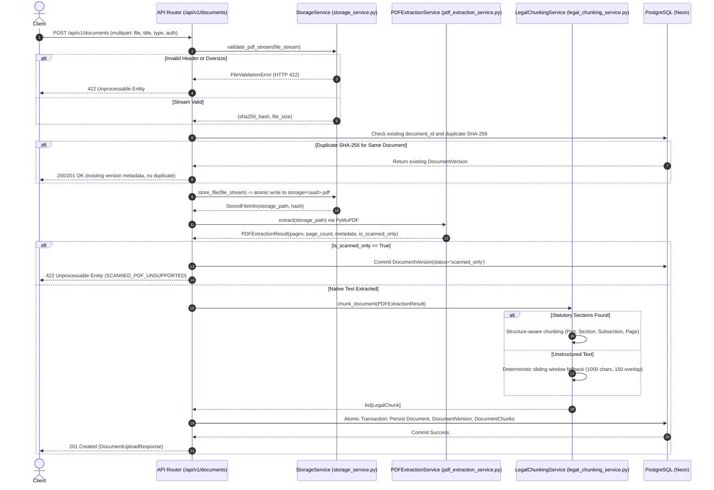

# LegalLens AI — Backend Architecture & Engineering Guide

**Module:** `apps/api`  
**Runtime:** Python 3.12.10 | FastAPI | Pydantic v2 | SQLAlchemy 2.x | PostgreSQL/Psycopg 3 | PyMuPDF | Alembic  
**Status:** Phase 3 Complete (Database & Document Intelligence)  
**Last Updated:** 4 November 2026

---

## 1. Overview & Architectural Boundaries

The LegalLens AI backend is designed as a **Modular Monolith** ([ADR-001](../decisions/architecture-decisions.md#adr-001-use-a-modular-monolithic-backend)) executed within a single Python runtime ([ADR-013](../decisions/architecture-decisions.md#adr-013-select-python-312-as-the-core-backend-runtime)).

Phase 1 (Backend Engineering Fundamentals) and Phase 2 (LLM Engineering) establish the foundational backend services, data modeling, error handling, and Gemini-powered LLM capabilities:
- **Centralized Configuration:** Type-safe settings loaded from `.env` via `pydantic-settings` with singleton caching (`gemini_model`, timeouts, retries, temperature).
- **Domain-Driven Error Hierarchy:** Uniform, sanitized error responses inheriting from `AppException` and `LLMException` with traceback masking.
- **Strict Data Validation:** Typed Pydantic v2 schemas for HTTP transport and structured LLM JSON outputs.
- **Decoupled Architecture:** Provider abstraction (`LLMProvider` Protocol), Prompt templates (`PromptTemplate`), and application services (`LLMService`, `LegalSourceService`).
- **Resilient Model Invocation:** Bounded retries with exponential backoff and jitter (`execute_with_retry`), `Retry-After` header respect, and strict 30s timeouts.
- **Deterministic Token Accounting:** Full capture of input, output, and native Gemini 2.5 Flash thinking tokens (`thoughtsTokenCount`) with mathematical cost estimation ($0.30/1M in, $2.50/1M out).
- **Privacy-Safe Telemetry:** Structured model-call logging compliant with [ADR-014](../decisions/architecture-decisions.md#adr-014-maintain-public-repository-with-strict-credential-isolation) (no prompts, document text, or secrets in logs).
- **100% Deterministic Testing:** 73 automated pytest tests (72 passed, 1 skipped offline integration test; 0 failed) with zero regression on Phase 1 tests.

---

## 2. Directory Structure & Responsibilities

```text
apps/api/
├── app/
│   ├── api/                     # HTTP transport & routing layer
│   │   ├── deps.py              # Reusable FastAPI dependency injection (Settings, Services, Providers)
│   │   ├── routes/              # Route endpoints grouped by domain resource
│   │   │   ├── health.py        # /health and /api/v1/health endpoints
│   │   │   └── sources.py       # /api/v1/sources (Sri Lankan legal source catalog)
│   │   └── v1/
│   │       └── router.py        # Centralized v1 router aggregating all domain sub-routers
│   ├── core/                    # Foundational utilities & cross-cutting concerns
│   │   ├── config.py            # Pydantic Settings loading and caching from .env
│   │   ├── errors.py            # Custom exceptions, handlers, and uniform ErrorResponse
│   │   ├── llm_errors.py        # LLM exception hierarchy (timeout, rate limit, validation)
│   │   ├── logging.py           # Standard Python logging configuration
│   │   ├── pricing.py           # Documented Gemini pricing rates & cost estimator
│   │   └── retries.py           # Bounded retry engine with exponential backoff & jitter
│   ├── db/                      # Database placeholders (preserved for Phase 3 PostgreSQL/pgvector)
│   ├── prompts/                 # Prompt management & templating
│   │   ├── base.py              # Reusable PromptTemplate abstraction
│   │   └── legal_prompts.py     # Authoritative legal query analysis prompt (v1.0.0)
│   ├── providers/               # LLM Provider abstraction & implementations
│   │   ├── base.py              # LLMProvider Protocol, TokenUsage, ProviderResponse
│   │   ├── fake_provider.py     # Deterministic fake provider for offline testing
│   │   └── gemini_provider.py   # Official Google GenAI SDK implementation
│   ├── schemas/                 # Data validation and serialization models (Pydantic v2)
│   │   ├── health.py            # HealthResponse and SystemStatusResponse schemas
│   │   ├── legal_source.py      # LegalSource, Authenticity, and Reference validation models
│   │   └── llm.py               # LLMCallTelemetry, structured outputs, validation helper
│   ├── services/                # Business logic decoupled from transport/framework
│   │   ├── legal_source_service.py # Sri Lankan legal source catalog and reference checks
│   │   └── llm_service.py       # LLM orchestration, structured workflow, telemetry logging
│   └── main.py                  # FastAPI application entrypoint and router mounting
├── scripts/
│   └── manual_test_llm.py       # Developer-only CLI script for real Gemini API integration testing
├── tests/                       # Automated pytest suite (72 passed, 1 skipped)
│   ├── conftest.py              # TestClient fixtures and setup
│   ├── test_config.py           # Configuration loading and singleton caching tests
│   ├── test_dependencies.py     # FastAPI dependency injection & override tests
│   ├── test_error_handling.py   # Uniform error response and traceback masking tests
│   ├── test_health_api.py       # Health and system status endpoint tests
│   ├── test_llm_config_and_pricing.py # Model settings, pricing registry, and telemetry tests
│   ├── test_llm_provider.py     # Provider protocol, GeminiProvider, and FakeLLMProvider tests
│   ├── test_llm_retries_and_errors.py # Retry engine, backoff, and transient error classification tests
│   ├── test_llm_service.py      # LLMService lifecycle, recovery, failure telemetry, and privacy tests
│   ├── test_llm_validation.py   # Prompt rendering, Pydantic schema validation, and error tests
│   ├── test_schemas.py          # Pydantic model validation and boundary constraint tests
│   └── test_sources_api.py      # REST endpoint functionality and HTTP status tests
├── .env                         # Local environment settings (sanitized, git-ignored)
├── .env.example                 # Environment template with dummy placeholders
├── pytest.ini                   # Pytest configuration for apps/api
└── requirements.txt             # Pinned Python dependencies (including google-genai)
```

---

## 3. Lifecycles & Sequence Workflows

### 3.1 HTTP Request Lifecycle (Phase 1)



### 3.2 LLM Service & Model Execution Lifecycle (Phase 2)



---

## 4. LLM Engineering Architecture (Phase 2 Core)

### 4.1 Provider Abstraction Layer

The provider abstraction decouples application logic from vendor SDK internals using a lightweight Python Protocol ([ADR-001](../decisions/architecture-decisions.md#adr-001-use-a-modular-monolithic-backend)):

```python
# apps/api/app/providers/base.py
@runtime_checkable
class LLMProvider(Protocol):
    def generate(self, prompt: str, temperature: float = 0.2) -> ProviderResponse: ...
    def generate_structured(
        self, prompt: str, response_schema: type[T], temperature: float = 0.2
    ) -> ProviderResponse: ...
```

#### TokenUsage & Thinking-Token Accounting
Gemini 2.5 Flash is a native reasoning model that generates internal reasoning tokens (`thoughtsTokenCount`) in addition to candidate output tokens (`candidatesTokenCount`).

```python
# apps/api/app/providers/base.py
@dataclass(frozen=True)
class TokenUsage:
    input_tokens: int | None
    output_tokens: int | None
    thinking_tokens: int | None
    total_tokens: int | None
```

- **Extraction Logic:** In `GeminiProvider`, `input_tokens` is read from `prompt_token_count`, `output_tokens` from `candidates_token_count`, and `thinking_tokens` from `thoughts_token_count`.
- **Discrepancy Resolution:** If `thoughts_token_count` is omitted but `total_tokens > input_tokens + output_tokens`, the difference is assigned to `thinking_tokens`.
- **Missing Data:** If usage metadata is unavailable, values remain `None` rather than assuming false zeros.

#### GeminiProvider (`apps/api/app/providers/gemini_provider.py`)
- Sourced exclusively through `google-genai` SDK (`google.genai.Client`).
- Translates floating-point seconds into integer milliseconds for `HttpOptions(timeout=int(timeout_seconds * 1000))`.
- Catches SDK-specific exceptions (`google.genai.errors.APIError`) and maps them to domain exceptions (`LLMRateLimitError`, `LLMTimeoutError`, `LLMProviderError`).

#### FakeLLMProvider (`apps/api/app/providers/fake_provider.py`)
- Provides deterministic, zero-network test double for unit testing.
- Features controllable canned responses, custom token usage, call tracking, and transient error simulation (`simulate_transient_failures`).

### 4.2 Prompt Engineering Architecture

Prompts are managed through the immutable `PromptTemplate` class (`apps/api/app/prompts/base.py`), enforcing complete separation between static system instructions and dynamic user inputs:

```python
# apps/api/app/prompts/base.py
@dataclass(frozen=True)
class PromptTemplate:
    template: str
    version: str
    system_instruction: str = ""
    def render(self, **kwargs: Any) -> str: ...
```

#### Legal Query Analysis Prompt (`LEGAL_QUERY_ANALYSIS_PROMPT`, v1.0.0)
Located in `apps/api/app/prompts/legal_prompts.py`, this prompt guides the model to analyze Sri Lankan employment law inquiries with explicit anti-hallucination guardrails:
1. Identify primary legal domain and sub-domains.
2. Formulate 1–4 specific legal issues.
3. Suggest potential statutory references strictly from Sri Lankan law (e.g., *Industrial Disputes Act*, *TEWA 1971*, *Payment of Gratuity Act 1983*).
4. Assess urgency level (`low`, `medium`, `high`, `critical`).
5. **Guardrail:** Strictly forbids generating unsupported legal conclusions, speculative factual claims, or non-existent statutory sections.

### 4.3 Structured Output Generation & Pydantic Validation

Structured JSON generation is enforced at the model level via `response_mime_type="application/json"` and `response_schema` in `GenerateContentConfig`.

#### Schema Compiler Constraints for Gemini OpenAPI
Google GenAI SDK compiles Pydantic models into OpenAPI schemas via `types.Schema`. To prevent compiler exceptions:
1. **No Defaults:** All fields must be explicitly required (`Field(...)`). The Gemini schema compiler rejects models with default values (`ValueError: Default value is not supported in the response schema`).
2. **No `extra="forbid"`:** Pydantic's `extra="forbid"` injects `additionalProperties: False`, which Google GenAI rejects. Models use `ConfigDict(frozen=True)` without `extra="forbid"`.

#### Output Validation Helper (`validate_structured_response`)
Located in `apps/api/app/schemas/llm.py`, this helper treats raw LLM output as untrusted text:
- Validates via Pydantic v2 `schema.model_validate_json(raw_text)`.
- Distinguishes syntax errors (`json_invalid`) from schema structure errors.
- Raises `LLMResponseValidationError` (HTTP 502) on validation failure.

### 4.4 Fault Tolerance: Bounded Retries & Timeouts

The retry utility `execute_with_retry()` (`apps/api/app/core/retries.py`) enforces strict boundaries:
- **Retry Budget:** `llm_max_retries=2` allows 2 retries after the initial attempt (up to 3 total attempts).
- **Exponential Backoff with Jitter:**
  $$\text{delay} = \min(\text{max\_delay}, \text{base\_delay} \times 2^{\text{attempt}} + \text{random\_jitter})$$
- **Transient Error Classification:**
  - *Retryable:* `LLMTimeoutError`, `LLMRateLimitError`, transient HTTP 502/503/504 errors, network connection failures.
  - *Non-Retryable (Fail Fast):* `LLMConfigurationError`, authentication errors (HTTP 401/403), client request errors (HTTP 400), and `LLMResponseValidationError`.
- **Provider Delay Awareness:** Honors upstream `Retry-After` headers where provided, bounded by a safe upper limit (60s).
- **Test Speed:** Injectable `sleep_fn` parameter allows unit tests to execute backoff logic instantly with zero real sleep.

### 4.5 Pricing Registry & Cost Estimation

LegalLens AI implements deterministic, centrally configured token cost estimation in `apps/api/app/core/pricing.py`.

#### Documented Rate Card (Google Gemini Paid Tier — Effective November 2026)
| Model | Input Rate (per 1M tokens) | Output Rate (per 1M tokens) | Thinking Rate (per 1M tokens) |
| :--- | :---: | :---: | :---: |
| `gemini-2.5-flash` | **$0.30** ($0.00000030/tok) | **$2.50** ($0.00000250/tok) | **$2.50** ($0.00000250/tok) |
| `gemini-2.0-flash` | **$0.10** ($0.00000010/tok) | **$0.40** ($0.00000040/tok) | N/A |
| `gemini-1.5-flash` | **$0.075** ($0.000000075/tok) | **$0.30** ($0.00000030/tok) | N/A |
| `gemini-1.5-pro` | **$1.25** ($0.00000125/tok) | **$5.00** ($0.00000500/tok) | N/A |

#### Cost Formulation
$$\text{Cost} = (\text{Input Tokens} \times \text{Input Rate}) + ((\text{Candidate Tokens} + \text{Thinking Tokens}) \times \text{Output Rate})$$

> [!NOTE]
> Thinking tokens generated by Gemini 2.5 Flash are billed at the standard output rate according to Google Cloud terms. If `total_tokens` is reported and exceeds the sum of input and candidate tokens, the remainder is counted as billable output.

### 4.6 Exception Hierarchy

All application exceptions inherit from `AppException` (`apps/api/app/core/errors.py`), providing consistent HTTP status codes and error responses:

```text
AppException (HTTP status code, message, error_code)
├── EntityNotFoundException (404)
├── ValidationException (422)
└── LLMException (500)
    ├── LLMConfigurationError (500)
    ├── LLMProviderError (502)
    ├── LLMTimeoutError (504)
    ├── LLMRateLimitError (429)
    └── LLMResponseValidationError (502)
```

### 4.7 Observability & Telemetry Architecture

LegalLens AI adopts a staged observability roadmap:
- **Phase 2 (Completed):** Model-call telemetry. Per-call metadata is captured via immutable `LLMCallTelemetry` records and logged via standard Python logging.
- **Phase 7 (Planned):** Agent & workflow observability (LangGraph step traces, node transitions, checkpointing).
- **Phase 9 (Planned):** Advanced observability & Harness Engineering (runtime budgets, cost caps, execution audits).

#### Privacy-Safe Operational Logging ([ADR-014](../decisions/architecture-decisions.md#adr-014-maintain-public-repository-with-strict-credential-isolation))
Logs emit structured operational metrics but strictly forbid sensitive user inputs:
- **Logged:** Correlation ID, model name, provider, latency (seconds), input tokens, output tokens, thinking tokens, total tokens, estimated cost (USD), retry count, success status, and sanitized error categories.
- **Forbidden from Logs:** Raw prompt text, user queries, full model responses, legal document contents, API keys, or provider authorization headers.

### 4.8 FastAPI Dependency Injection

FastAPI dependency injection in `apps/api/app/api/deps.py` provides clean provider and service lifecycles:

```python
# apps/api/app/api/deps.py
def get_llm_provider(settings: Annotated[Settings, Depends(get_settings)]) -> LLMProvider:
    return GeminiProvider(
        api_key=settings.gemini_api_key,
        model=settings.gemini_model,
        timeout_seconds=settings.llm_timeout_seconds,
    )

def get_llm_service(
    provider: Annotated[LLMProvider, Depends(get_llm_provider)],
    settings: Annotated[Settings, Depends(get_settings)],
) -> LLMService:
    return LLMService(
        provider=provider,
        max_retries=settings.llm_max_retries,
        default_temperature=settings.llm_temperature,
    )
```

---

## 5. Developer Manual Integration Testing & Live Verification

To verify the Gemini integration without creating premature public API endpoints, a developer-only CLI script is provided.

### 5.1 Manual Testing Script (`apps/api/scripts/manual_test_llm.py`)

Run the script from the repository root:

```powershell
# Windows PowerShell
$env:GEMINI_API_KEY="your-gemini-api-key"
.\venv\Scripts\python.exe apps/api/scripts/manual_test_llm.py --query "My employer terminated me without notice after 5 years. Is this legal?"
```

Supported options:
- `--query`: The legal research inquiry text to analyze.
- `--model`: Override the model name (default: `gemini-2.5-flash`).
- `--temperature`: Override generation temperature (default: `0.2`).
- `--dry-run`: Use `FakeLLMProvider` offline without network calls or API credentials.

### 5.2 Real-World Live Verification Records

Two live end-to-end executions were performed against Google Gemini 2.5 Flash:

| Metric | Live Execution 1 | Live Execution 2 | Analysis & Explanation |
| :--- | :--- | :--- | :--- |
| **Model** | `gemini-2.5-flash` | `gemini-2.5-flash` | Configured default model |
| **Input Tokens** | 319 | 319 | Stable prompt template + user query |
| **Candidate Output Tokens** | 248 | 229 | Visible structured JSON response text |
| **Thinking Tokens** | 451 | 1,084 | Internal reasoning tokens (`thoughtsTokenCount`) |
| **Total Tokens** | 1,018 | 1,632 | Exact aggregate reported by Gemini API |
| **Total Billable Output** | 699 tokens | 1,313 tokens | Candidate tokens + Thinking tokens |
| **Estimated Cost (USD)** | **$0.00184320** | **$0.00337820** | Formula: $(319 \times \$0.30 + \text{Output} \times \$2.50) / 10^6$ |
| **Roundtrip Latency** | 5.57 seconds | 7.96 seconds | Network latency + reasoning + generation |
| **Retry Count** | 0 | 0 | First-attempt success on both executions |
| **Pydantic Validation** | **PASSED** | **PASSED** | Successfully validated into `LegalQueryAnalysisResult` |

#### Understanding the Token Discrepancy & Reasoning Tokens
During live testing, initial observation showed prompt tokens (319) + candidate tokens (248) = 567 tokens, yet total tokens was reported as 1,018. Investigation revealed that **Gemini 2.5 Flash generates internal reasoning thoughts** prior to emitting structured output. The Google GenAI SDK returns these under `usage_metadata.thoughts_token_count` (451 tokens in Run 1; 1,084 tokens in Run 2). The sum $(319 + 248 + 451 = 1,018)$ accounts for 100% of the reported tokens.

> [!IMPORTANT]
> **Cost Accounting Clarification:** All reported costs are mathematical estimates derived from official rate cards ($0.30/1M input, $2.50/1M output/thinking effective November 2026). They do not represent official Google Cloud invoice statements. Live calls were performed strictly for verification; offline automated test suites use `FakeLLMProvider` and remain 100% decoupled from external network availability.

---

## 6. Database & Document Intelligence Architecture (Phase 3 Core)

### 6.1 Relational Schema Architecture

LegalLens AI implements a normalized three-tier relational schema in PostgreSQL designed for immutable document versioning and exact legal evidence traceability ([ADR-003](../decisions/architecture-decisions.md#adr-003-use-postgresql-as-the-primary-database)):



### 6.2 End-to-End Document Ingestion Pipeline Lifecycle



### 6.3 Database Migrations & Versioning Strategy

Database schemas are strictly managed using **Alembic** rather than ad-hoc table creation.
- Migration scripts reside in `apps/api/alembic/versions/`.
- `env.py` dynamically sources configuration from `get_settings().database_url` with credential masking in logs.
- Initial migration `a62920676c1e_create_phase_3_document_tables.py` establishes tables, foreign keys with `CASCADE` deletes, check constraints (`version_number > 0`, `page_number >= 1`, non-empty text), and performance indexes (`file_hash`, `section_reference`, `document_version_id + page_number`).
- Migration lifecycle verified against PostgreSQL: `upgrade head` $\to$ `current` $\to$ `downgrade -1` $\to$ `upgrade head`.

---

## 7. Implemented Endpoints (HTTP Transport)

| Method | Endpoint | Description | Status Codes | Response Model |
| :--- | :--- | :--- | :--- | :--- |
| `GET` | `/health` | Unversioned operational liveness check | `200` | `{"status": "healthy"}` |
| `GET` | `/api/v1/health` | Versioned system diagnostics & metadata | `200` | `SystemStatusResponse` |
| `GET` | `/api/v1/sources` | List authoritative Sri Lankan legal sources (optional `?category=` filter) | `200` | `LegalSourceListResponse` |
| `GET` | `/api/v1/sources/{source_id}` | Retrieve specific legal source by slug | `200`, `404` | `LegalSourceResponse` |
| `POST` | `/api/v1/sources/validate-reference` | Validate statutory section reference format | `200`, `404`, `422` | `StatuteReferenceValidationResponse` |
| `POST` | `/api/v1/documents` | Ingest legal PDF with structure-aware chunking and storage | `201`, `404`, `409`, `422` | `DocumentUploadResponse` |
| `GET` | `/api/v1/documents` | List catalogued legal documents with active version counts | `200` | `DocumentListResponse` |
| `GET` | `/api/v1/documents/{document_id}` | Retrieve document metadata and version summaries | `200`, `404` | `DocumentDetailResponse` |
| `GET` | `/api/v1/documents/{document_id}/versions/{version_number}/chunks` | Retrieve extracted chunks with legal hierarchy & page bounds | `200`, `404` | `DocumentVersionChunksResponse` |
| `GET` | `/api/v1/documents/{document_id}/versions/{version_number}/download` | Generate time-limited presigned URL for downloading original PDF | `200`, `404` | `PresignedDownloadResponse` |
| `GET` | `/api/v1/documents/download-file` | Stream locally stored PDF object via signed URL verification | `200`, `403`, `404` | File stream (`application/pdf`) |
| `DELETE` | `/api/v1/documents/{document_id}/versions/{version_number}` | Soft-delete a document version & purge chunks from active DB | `200`, `404` | `DocumentVersionSoftDeleteResponse` |
| `POST` | `/api/v1/documents/{document_id}/versions/{version_number}/restore` | Restore soft-deleted document version and recover its chunks | `200`, `404` | `DocumentVersionRestoreResponse` |
| `POST` | `/api/v1/documents/{document_id}/versions/{version_number}/retry` | Re-process extraction and chunking for a failed document version | `200`, `404` | `DocumentVersionRetryResponse` |
| `GET` | `/docs` | Interactive Swagger / OpenAPI documentation | `200` | HTML UI |
| `GET` | `/redoc` | Interactive ReDoc documentation | `200` | HTML UI |

---

## 8. Setup & Execution Commands

### 8.1 Environment Activation
From repository root:
```powershell
.\venv\Scripts\Activate.ps1
python --version   # Must be Python 3.12.x
```

### 8.2 Database Migrations (Alembic)
```powershell
$env:PYTHONPATH="apps/api"
.\venv\Scripts\alembic.exe upgrade head
.\venv\Scripts\alembic.exe current
```

### 8.3 Running Automated Tests
```powershell
# Run complete test suite (127 passed, 1 skipped)
.\venv\Scripts\python.exe -m pytest -v

# Run live PostgreSQL integration verification
.\venv\Scripts\python.exe -m pytest apps/api/tests/test_postgres_document_integration.py -v
```

### 8.4 Running the Development Server
```powershell
.\venv\Scripts\uvicorn.exe app.main:app --app-dir apps/api --reload --port 8000
```

---

## 9. Important Architectural Decisions & Trade-offs

1. **Source Authenticity Non-Self-Certification Gate:** Arbitrary client uploads cannot self-certify as `VerifiedOfficial` or `VerifiedSecondary`. Uploads default to `Unverified` (or `SyntheticDemo` for test fixtures). Any upload attempting to declare official authenticity without authoritative provenance is rejected with HTTP 422 `VALIDATION_ERROR`. Official status requires the authoritative legal verification workflow.
2. **Native-Text First & Scanned PDF Rejection ([ADR-010](../decisions/architecture-decisions.md#adr-010-use-native-text-pdf-extraction-initially)):** OCR is deferred to keep the system deterministic and free from heavy native binary dependencies (Tesseract). Scanned PDFs are flagged and persisted with `scanned_only` status, returning HTTP 422.
3. **Three-Tier Immutability Architecture:** Separating logical `Document` from physical `DocumentVersion` ensures historical statute amendments, revisions, and gazette printings can be ingested without destroying earlier evidence.
4. **Evidence Traceability Guarantee:** Chunks store exact 1-based start page (`page_number`) and end page (`page_end` when spanning multiple pages) and normalized SHA-256 hashes, preventing hallucinations in future citation verification (Phase 8).
5. **Content-Based File Validation:** The server strictly checks `%PDF-` magic bytes and opens files with PyMuPDF rather than trusting user MIME headers.
6. **UUID-Based Storage Paths:** Storage filenames use random UUIDs within a restricted `storage_dir`, completely eliminating path traversal vulnerabilities.
7. **Statutory Heading Recognition with Continuation & Fallback:** Parses Sri Lankan statutory formats (`Part IVA`, `Chapter II`, `Section 31B`, `(1)`, `(a)`), supports multi-page section continuation headers (e.g. `Section 31B. Continued.`), and falls back to bounded sliding-window chunking for unstructured legal notices.

---

## 10. Known Limitations & Roadmap Boundaries

- **Multi-Tenant Isolation & User Ownership (Deferred to Phase 10):** User-level identity, authentication (JWT/OAuth2), multi-tenant isolation, user workspaces, and research projects are formally scheduled for **Phase 10**. Current document ingestion and inspection APIs catalog public Sri Lankan legal authorities and are **not production-ready for private, confidential, or multi-user tenant documents**.
- **Dense Vector Embeddings & pgvector (Scheduled for Phase 4):** Phase 3 persists text, structural legal hierarchies, and physical page references in PostgreSQL. Vector embeddings, dense similarity indexes, and semantic search are implemented in **Phase 4**.
- **OCR Pipeline for Historical Scans (Scheduled for Phase 9):** Scanned image-only PDFs without native text layers cannot be extracted; they are persisted as `scanned_only` and rejected with HTTP 422. An asynchronous OCR pipeline (Tesseract/Surya) is scheduled for **Phase 9**.
- **DOCX and TXT Ingestion:** In adherence to Phase 3 milestone requirements, PDF ingestion is implemented completely. DOCX and plain-text ingestion remain planned for later phases.
- **Production Storage Hardening & Advanced Governance (Scheduled for Phase 11):** S3 bucket lifecycle policies, object versioning replication, antivirus/malware scanning streams, and automated retention policies belong to **Phase 11**.
