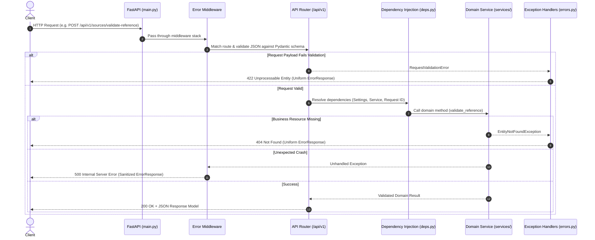

# LegalLens AI — Backend Architecture & Engineering Guide

**Module:** `apps/api`  
**Runtime:** Python 3.12.10 | FastAPI | Pydantic v2  
**Status:** Phase 1 Complete (Backend Engineering Fundamentals)  
**Last Updated:** 2 November 2026

---

## 1. Overview & Architectural Boundaries

The LegalLens AI backend is designed as a **Modular Monolith** ([ADR-001](file:///C:/Users/shaki/Desktop/LegalLense/docs/decisions/architecture-decisions.md#adr-001-use-a-modular-monolithic-backend)) executed within a single Python runtime ([ADR-013](file:///C:/Users/shaki/Desktop/LegalLense/docs/decisions/architecture-decisions.md#adr-013-select-python-312-as-the-core-backend-runtime)).

Phase 1 establishes the engineering fundamentals:
- Type-safe, centralized configuration management.
- Standard Python logging with uniform formatting.
- Domain-driven error handling with sanitized, predictable HTTP error responses.
- Typed Pydantic request and response schemas with boundary constraints.
- Decoupled domain service layer with clean separation from HTTP request handling.
- FastAPI dependency injection.
- Versioned REST routing under `/api/v1` alongside unversioned operational health checks.
- 100% deterministic test coverage with Pytest and HTTPX.

---

## 2. Directory Structure & Responsibilities

```text
apps/api/
├── app/
│   ├── api/                     # HTTP transport & routing layer
│   │   ├── deps.py              # Reusable FastAPI dependency providers
│   │   ├── routes/              # Route endpoints grouped by domain resource
│   │   │   ├── health.py        # /health and /api/v1/health endpoints
│   │   │   └── sources.py       # /api/v1/sources (Sri Lankan legal source catalog)
│   │   └── v1/
│   │       └── router.py        # Centralized v1 router aggregating all domain sub-routers
│   ├── core/                    # Cross-cutting foundational utilities
│   │   ├── config.py            # Pydantic Settings loading and caching from .env
│   │   ├── errors.py            # Custom exceptions, handlers, and uniform ErrorResponse
│   │   └── logging.py           # Standard Python logging configuration
│   ├── db/                      # Database placeholders (preserved for Phase 3 PostgreSQL/pgvector)
│   ├── schemas/                 # Data validation and serialization models (Pydantic v2)
│   │   ├── health.py            # HealthResponse and SystemStatusResponse schemas
│   │   └── legal_source.py      # LegalSource, Authenticity, and Reference validation models
│   ├── services/                # Business logic decoupled from transport/framework
│   │   └── legal_source_service.py # Sri Lankan legal source catalog and reference checks
│   └── main.py                  # FastAPI application entrypoint and router mounting
├── tests/                       # Automated pytest suite
│   ├── conftest.py              # TestClient fixtures and setup
│   ├── test_config.py           # Configuration loading and singleton caching tests
│   ├── test_dependencies.py     # FastAPI dependency injection & override tests
│   ├── test_error_handling.py   # Uniform error response and traceback masking tests
│   ├── test_health_api.py       # Health and system status endpoint tests
│   ├── test_schemas.py          # Pydantic model validation and boundary constraint tests
│   └── test_sources_api.py      # REST endpoint functionality and HTTP status tests
├── .env                         # Local environment settings (sanitized, git-ignored)
├── .env.example                 # Environment template with dummy placeholders
├── pytest.ini                   # Pytest configuration for apps/api
└── requirements.txt             # Pinned Phase 1 Python dependencies
```

---

## 3. Request Lifecycle

The following diagram illustrates how an incoming HTTP request traverses the backend architecture:



---

## 4. Implemented Endpoints

| Method | Endpoint | Description | Status Codes | Response Model |
| :--- | :--- | :--- | :--- | :--- |
| `GET` | `/health` | Unversioned operational liveness check | `200` | `{"status": "healthy"}` |
| `GET` | `/api/v1/health` | Versioned system diagnostics & metadata | `200` | `SystemStatusResponse` |
| `GET` | `/api/v1/sources` | List authoritative Sri Lankan legal sources (optional `?category=` filter) | `200` | `LegalSourceListResponse` |
| `GET` | `/api/v1/sources/{source_id}` | Retrieve specific legal source by slug | `200`, `404` | `LegalSourceResponse` |
| `POST` | `/api/v1/sources/validate-reference` | Validate statutory section reference format | `200`, `404`, `422` | `StatuteReferenceValidationResponse` |
| `GET` | `/docs` | Interactive Swagger / OpenAPI documentation | `200` | HTML UI |
| `GET` | `/redoc` | Interactive ReDoc documentation | `200` | HTML UI |

---

## 5. Setup & Execution Commands

### 5.1 Environment Activation

From the repository root:

```powershell
# Windows PowerShell
.\venv\Scripts\Activate.ps1

# Verify Python version (must be 3.12.x)
python --version
```

### 5.2 Dependency Installation

```powershell
.\venv\Scripts\pip.exe install -r apps/api/requirements.txt
```

### 5.3 Running the Development Server

From repository root:
```powershell
.\venv\Scripts\uvicorn.exe app.main:app --app-dir apps/api --reload --port 8000
```

Or from `apps/api/`:
```powershell
cd apps/api
..\..\venv\Scripts\uvicorn.exe app.main:app --reload --port 8000
```

Access:
- Liveness check: `http://localhost:8000/health`
- API v1 status: `http://localhost:8000/api/v1/health`
- Swagger UI: `http://localhost:8000/docs`
- ReDoc: `http://localhost:8000/redoc`

### 5.4 Running Automated Tests

From repository root:
```powershell
.\venv\Scripts\python.exe -m pytest -v
```

Or from `apps/api/`:
```powershell
cd apps/api
..\..\venv\Scripts\python.exe -m pytest -v
```

---

## 6. Important Architectural Decisions & Trade-offs

1. **Pure Standard Library Logging:** We utilized standard Python `logging` with structured formatting instead of introducing heavyweight external logging frameworks (e.g. `loguru` or structlog). This minimizes external dependency surface while fulfilling Phase 1 requirements.
2. **Pydantic Settings with Singleton Caching:** Configuration is validated via `pydantic-settings` and memoized with `@lru_cache`, ensuring configuration is parsed once at startup rather than on every HTTP request.
3. **Traceback Masking Middleware:** To enforce [ADR-014](file:///C:/Users/shaki/Desktop/LegalLense/docs/decisions/architecture-decisions.md#adr-014-maintain-public-repository-with-strict-credential-isolation) and strict security boundaries, unhandled 500 errors are trapped by an outer HTTP middleware and sanitized into a standardized `ErrorResponse` schema, preventing Python stack traces, file system paths, or environment variables from leaking to clients.
4. **Scope Discipline:** In strict adherence to Phase 1 boundaries, no database persistence (PostgreSQL/SQLAlchemy), vector embeddings, LLM orchestration, or PDF parsers are present. Representative endpoints operate over in-memory domain fixtures representing authentic Sri Lankan Employment Law statutes (*Industrial Disputes Act No. 43 of 1950*, *TEWA 1971*, *Payment of Gratuity Act 1983*).

---

## 7. Known Limitations

- **In-Memory Catalog:** The legal source catalog is currently in-memory. Persistent storage and dynamic queries will be implemented in Phase 3 (Database & Document Intelligence) using Neon PostgreSQL.
- **Statutory Section Parsing:** Current section validation checks existence and format structure; full semantic text extraction and cross-referencing will be introduced in Phase 3 and Phase 8.
