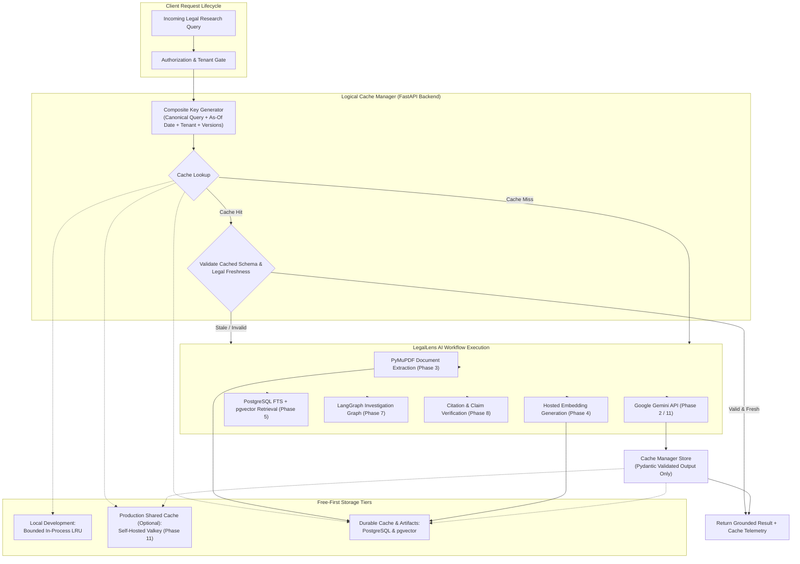

# LegalLens AI — Version-Aware Caching Strategy & Architecture

> **Document Type:** Technical Architecture Specification  
> **Target Status:** Proposed Architecture — Documentation Only / Not Implemented  
> **Effective Date:** 4 November 2026  
> **Scope:** Entire LegalLens AI Platform (Phase 2 through Phase 12)  
> **Related Documents:**  
> - [`PROJECT_PROPOSAL_REPORT.md`](../../PROJECT_PROPOSAL_REPORT.md)  
> - [`README.md`](../../README.md)  
> - [`docs/decisions/architecture-decisions.md`](../decisions/architecture-decisions.md) (ADR-015)  
> - [`docs/architecture/system-architecture.md`](system-architecture.md)  
> - [`docs/architecture/backend-architecture.md`](backend-architecture.md)

---

> [!IMPORTANT]
> ### Implementation Boundary Notice
> This document specifies the future caching architecture for LegalLens AI. **This specification is documentation-only and is strictly not yet implemented in code.**
> 
> Introducing this document does not add runtime caching code, software dependencies (such as Redis, Valkey, or diskcache), environment variables, Docker Compose services, database tables, or database migrations. Implementation of each caching tier is deferred strictly to its designated phase in the development roadmap.

---

## 1. Purpose and Scope

LegalLens AI is an evidence-grounded agentic AI platform for Sri Lankan legal research, initially focused on Employment Law. The platform performs computationally demanding and latency-sensitive operations:
- Native-text PDF parsing and passage extraction.
- Dense embedding generation for statutory provisions and judicial decisions.
- Hybrid lexical (PostgreSQL Full-Text Search) and semantic (pgvector) information retrieval.
- Multi-step agentic research workflows governed by LangGraph.
- Claim-level citation verification against authoritative primary sources.
- Structured legal query analysis and synthesis using Google Gemini Large Language Models.

Without systematic caching, repeated inquiries or identical statutory lookups generate redundant external API token expenditure, unnecessary database load, and increased roundtrip latency.

However, legal research software cannot apply caching as an indiscriminate key-value optimization. Legal data carries strict correctness requirements:
1. **Statutory Dynamism:** Statutes are amended, repealed, or substituted by the Sri Lankan Parliament over time.
2. **Precedential Evolution:** Judicial interpretations of the Supreme Court and Court of Appeal may refine, distinguish, or overrule earlier rulings.
3. **Factual Sensitivity:** Superficially identical legal queries often turn on subtle factual differences (e.g., employment duration, scheduled employment status under TEWA, or probation status), resulting in completely different legal consequences.
4. **Data Confidentiality & Tenant Isolation:** User research projects, internal dispute records, and private documents must never leak across tenant or user boundaries.
5. **AI Truthfulness:** Cached model generations are assistive, AI-generated legal analyses, not official statutory enactments.

The primary objective of this architecture is to establish a **version-aware, legally safe, and cost-disciplined caching strategy** that accelerates response times and minimizes token consumption without ever compromising legal veracity or tenant security.

---

## 2. Current Implementation Status

| Milestone | Status | Caching Scope & Engineering Status |
| :--- | :---: | :--- |
| **Phase 0 — Project Foundation** | **Completed** | Monorepo layout, Python 3.12.10 virtual environment, security isolation rules, initial ADRs (ADR-001 through ADR-014). |
| **Phase 1 — Backend Fundamentals** | **Completed** | Modular FastAPI architecture, Pydantic v2 schemas, domain error handling, in-memory legal source catalog. |
| **Phase 2 — LLM Engineering** | **Completed** | **Lightweight immutability and versioning established:**<br/>• `@dataclass(frozen=True) PromptTemplate` in `app/prompts/base.py` enforces immutability and explicit versioning (`name` and `version`).<br/>• Module-level singleton reuse of authoritative prompts (`LEGAL_QUERY_ANALYSIS_PROMPT` v1.0.0).<br/>• Cached application settings singleton via `@lru_cache` in `app/core/config.py`.<br/>• Provider `TokenUsage` captures `cached_tokens` (`cached_content_token_count`).<br/>• `ModelPricing` and `estimate_cost` account for discounted cached token rates ($0.03/1M cached tokens).<br/>• **No premature application-level response cache or external cache infrastructure was introduced.** |
| **Phase 3 — Database & Document Intelligence** | **In Progress** | Schema design and PyMuPDF document extraction. Extraction cache metadata design planned. |
| **Phase 4 through Phase 12** | **Planned** | Caching tiers deferred to their designated roadmap milestones. |

---

## 3. Caching Design Principles

The LegalLens AI caching strategy is anchored in seven architectural principles:

1. **Evidence and Legal Correctness First:** Never sacrifice legal accuracy for latency or cache hit rates. Presenting a stale, overruled, or misapplied legal conclusion is unacceptable in legal technology.
2. **Version-Aware Invalidation Over TTL Expiry:** Time-To-Live (TTL) is merely a secondary safety mechanism. Explicit version tags (document version, parser version, prompt version, model version, corpus snapshot, schema version) govern cache validity. When an authoritative source or software component changes, cached artifacts are invalidated immediately regardless of remaining TTL.
3. **Deterministic First ([ADR-009](../decisions/architecture-decisions.md#adr-009-keep-critical-operations-deterministic)):** Database lookups, access-control decisions, statutory reference validations, and report renderings must be performed in deterministic code. Caching must never bypass deterministic authorization or audit gates.
4. **Defense-in-Depth Security & Tenant Isolation ([ADR-014](../decisions/architecture-decisions.md#adr-014-maintain-public-repository-with-strict-credential-isolation)):** Cached results must enforce tenant boundaries. User authorization is verified before returning any cached object. Sensitive inputs within cache keys are transformed using keyed cryptographic hashes to prevent data leakage in cache logs.
5. **Resilient Graceful Degradation (Fail-Open):** Cache backend failures, connection drops, or timeouts must never crash or hang the primary research workflow. If the cache is unreachable, the system logs a diagnostic warning and executes the uncached computation path.
6. **Free-First Infrastructure Discipline:** Avoid proprietary or paid cache SaaS subscriptions. Durable cache data is stored natively in PostgreSQL and pgvector. High-throughput shared caching, if justified in Phase 11, will utilize self-hosted open-source Valkey.
7. **Telemetry and Accounting Integrity:** A cache hit is not a new Gemini API call. Caching telemetry must record avoided API calls, avoided tokens, and estimated cost savings separately without falsifying cached outputs as fresh model invocations.

---

## 4. Logical Architecture

Caching operations are coordinated through a centralized, logical **Cache Manager** within the FastAPI backend monolith. Application services interact with caching capabilities through a consistent Python protocol rather than directly accessing storage backends.



### 4.1 Storage Tier Separation
- **Durable Cache Store (PostgreSQL):** Stores persistent extraction artifacts, document metadata fingerprints, and immutable content hashes. Survives application restarts and infrastructure scaling.
- **Vector Cache Store (pgvector):** Retains document chunk embeddings and index structures directly within PostgreSQL, maintaining foreign-key relationships to primary legal documents.
- **Transient Shared Cache (Valkey, Optional for Phase 11):** High-speed, in-memory key-value cache for short-lived retrieval candidate sets and validated exact LLM responses across multi-worker Uvicorn processes.
- **In-Process Cache (Local Development / Testing):** Thread-safe, bounded memory cache (`cachetools.LRUCache`) used during local development and automated pytest test suites to maintain zero external network dependencies.

---

## 5. Cache Techniques by System Component

### 5.1 Exact LLM Response Caching
- **Purpose:** Eliminate repeated Gemini API calls for identical, validated legal research inquiries.
- **Roadmap Phase:** Phase 11 — Production Engineering.
- **Cache Identity Requirements:** The cache key must incorporate all dimensions affecting generation output:
  - Canonicalized query text (trimmed, normalized whitespace, case-preserved for citations).
  - Jurisdiction identifier (e.g., `LK`).
  - Legal as-of date (temporal validity boundary).
  - Tenant ID and user authorization scope.
  - Immutable prompt template identifier and version tag.
  - Provider name and model identifier (e.g., `gemini-2.5-flash`).
  - Response schema version (e.g., `LegalQueryAnalysisResult` v1).
  - Generation parameters (temperature, top_p).
  - Active legal corpus snapshot or search index version.
- **Validation Rule:** Only successful, fully validated Pydantic model outputs are cached. Unvalidated, malformed, partial, or failed calls are never cached.

### 5.2 Semantic Caching (Policy & Restrictions)
- **Status:** **Disabled by Default and Deferred.**
- **Policy:** Semantic caching of final legal answers and research reports is strictly forbidden.
- **Rationale:** In Sri Lankan Employment Law, queries that appear semantically adjacent (e.g., "termination of an executive after 8 months" vs. "termination of a workman after 8 months") trigger fundamentally distinct legal statutory regimes (common law contractual termination vs. TEWA statutory protection). Reusing answers based on vector distance introduces unacceptable risks of misleading legal citations and advice.
- **Permissible Post-MVP Scope:** Semantic candidate reuse may be considered only for low-risk, non-authoritative operations (such as query typo suggestions or search keyword hints) after thorough false-hit benchmarking.

### 5.3 Prompt / Context Caching
- **Prompt Immutability:** Enforced in Phase 2 using `@dataclass(frozen=True) PromptTemplate`, ensuring system instructions and templates cannot be modified at runtime.
- **Prompt Versioning:** Every template carries an explicit `version` attribute (e.g., `1.0.0`), which is incorporated into downstream cache keys.
- **Gemini Provider-Side Context Caching:**
  - Google Gemini API supports context caching (`client.caches`) for large contexts at discounted rates ($0.03/1M cached tokens vs. $0.30/1M standard input tokens).
  - *Technical Constraint:* The official Google GenAI SDK enforces a **minimum threshold of 32,768 input tokens** for context caching on Flash models and incurs an hourly storage TTL fee.
  - *Phase 2 Finding:* Light query analysis prompts consume ~300 tokens, rendering provider-side caching technically impossible (violates 32k token minimum) and economically inefficient. Provider-side caching will be revisited in Phase 7/11 if large statutory corpuses or case volumes are held persistently in context.

### 5.4 Document Extraction Caching
- **Purpose:** Cache native-text PDF extraction outputs produced by PyMuPDF to avoid repeated PDF parsing, OCR checks, and character decoding.
- **Roadmap Phase:** Phase 3 — Database & Document Intelligence.
- **Cache Identity:** Keyed by:
  - Source file SHA-256 checksum.
  - Document version number.
  - Extractor implementation and version tag (e.g., `pymupdf==1.25.0`).
  - Extraction options (header/footer removal, table formatting).
- **Provenance Preservation:** Cached extraction artifacts must preserve exact document identity, page numbers, text offsets, bounding boxes, and statutory section headings.
- **Invalidation:** Triggered automatically when the physical PDF is updated, the file checksum changes, or extraction parsing parameters are modified.

### 5.5 Embedding Caching
- **Purpose:** Cache dense vector embeddings of statutory sections, regulations, and case law passages to eliminate redundant embedding API calls.
- **Roadmap Phase:** Phase 4 — Embeddings & Basic RAG.
- **Cache Identity:** Keyed by:
  - Normalized text content SHA-256 hash.
  - Embedding provider name and model identifier (e.g., `text-embedding-004`).
  - Vector dimensionality (e.g., 768).
  - Text preprocessing and chunking version.
- **Legal Source Independence:** Identical text strings appearing in different legal instruments must not conflate source provenance. The embedding vector is cached by content hash, but its associations with specific statutory documents and sections are maintained as distinct relational records in PostgreSQL/pgvector.

### 5.6 Retrieval-Result Caching
- **Purpose:** Cache candidate passage result sets from lexical search to reduce PostgreSQL query load for frequent search terms.
- **Roadmap Phase:** Phase 5 — Hybrid Retrieval Engineering.
- **Cache Identity:** Keyed by:
  - Normalized keyword query string.
  - Metadata filters (statute ID, court, date range, authenticity classification).
  - Tenant and user access scope.
  - PostgreSQL Full-Text Search index version.
- **TTL & Expiry:** Short-lived TTL (up to 15 minutes) with immediate invalidation upon document updates or index rebuilds.

### 5.7 Hybrid Search Caching
- **Purpose:** Cache ranked candidate sets generated by combining PostgreSQL Full-Text Search (lexical) and pgvector (semantic) via Reciprocal Rank Fusion (RRF).
- **Roadmap Phase:** Phase 5 — Hybrid Retrieval Engineering.
- **Cache Identity:** Keyed by:
  - Composite query fingerprint (normalized text and query vector hash).
  - Active metadata filters and tenant scope.
  - RRF ranking parameters ($k=60$, lexical/semantic weighting).
  - Active corpus snapshot version.
- **TTL Policy:** Up to 15 minutes. Invalidation triggered immediately when primary documents or annotations change.

### 5.8 LangGraph Node-Level Caching
- **Purpose:** Cache deterministic, idempotent node executions within the agentic research graph.
- **Roadmap Phase:** Phase 7 — Agentic AI Engineering.
- **Node Caching vs. Checkpointing:**
  - *LangGraph Checkpointing:* Stores full workflow execution state to support pause/resume, audit trails, human-in-the-loop approval gates, and crash recovery. It is scoped to an individual execution thread.
  - *Node-Level Result Caching:* Reuses validated computational outputs (such as query analysis or statutory reference expansion) across disparate execution threads.
- **Restriction:** Scoped strictly to pure, deterministic node functions. Non-deterministic nodes or open synthesis steps are not cached at the node level.

### 5.9 Citation Verification Caching
- **Purpose:** Cache claim-to-passage verification determinations (`Supported`, `Partially supported`, `Unsupported`, `Contradicted`, `Ambiguous`).
- **Roadmap Phase:** Phase 8 — Legal Analysis & Citation Verification.
- **Cache Identity:** Keyed by:
  - Source document ID and version.
  - Passage text SHA-256 hash.
  - Normalized claim statement hash.
  - Verification algorithm and prompt version.
- **Invalidation:** Purged immediately if the underlying statutory passage is amended or the verification rules are revised.

### 5.10 Report-Generation Caching
- **Purpose:** Optimize final research report rendering.
- **Roadmap Phase:** Phase 11 — Production Engineering.
- **Strategy:** Prefer caching validated intermediate findings (retrieval sets, verification matrices) rather than caching completed final reports.
- **Restriction:** Final reports are not shared broadly across users. Each report is generated and rendered deterministically for a specific research project and tenant scope.

---

## 6. Cache Identity and Key Design

To prevent key collisions, security leaks, and stale data reuse, cache keys must follow a uniform, structured namespacing convention.

### 6.1 Key Generation Rules
1. **Canonicalization:** Input query strings are trimmed of leading/trailing whitespace, normalized to standard NFC Unicode, and collapsed of duplicate internal whitespace.
2. **Deterministic Ordering:** Dictionary filters, metadata constraints, and set arguments are sorted alphabetically by key before hashing.
3. **Cryptographic Hashing:**
   - Standard components: Hex-encoded `SHA-256`.
   - Sensitive user queries and private context: Hex-encoded `HMAC-SHA-256` using an application secret salt to prevent raw user queries from appearing in cache key listings.
4. **Namespace Structure:** `ll:<workload>:<version>:<composite_hash>`

### 6.2 Key Specifications by Workload

```text
# Exact LLM Response Key
ll:llm:v1:<sha256(canonical_query + jurisdiction + as_of_date + tenant_id + prompt_version + model_id + schema_version + corpus_version)>

# Document Extraction Key
ll:extract:v1:<sha256(file_sha256 + doc_version + extractor_version + extraction_options)>

# Embedding Key
ll:embed:v1:<sha256(normalized_text + provider + model_id + dimensions + chunking_version)>

# Retrieval & Hybrid Search Key
ll:search:v1:<sha256(query_fingerprint + filters_json + tenant_id + rrf_params + index_version)>

# LangGraph Node Key
ll:node:v1:<sha256(node_name + input_state_hash + model_id + prompt_version)>

# Citation Verification Key
ll:verify:v1:<sha256(source_id + source_version + passage_hash + claim_hash + verifier_version)>
```

---

## 7. TTL and Invalidation Policy

### 7.1 Initial TTL Guidelines

TTL settings serve as backstop expirations. Version-aware invalidation rules always take precedence.

| Cache Category | Initial TTL Policy | Persistence Tier | Primary Invalidation Trigger |
| :--- | :---: | :---: | :--- |
| **Exact LLM Response** | Up to 1 hour | Transient / Valkey | Statutory update, tenant change, prompt/model bump |
| **Retrieval & Hybrid Search** | Up to 15 minutes | Transient / Valkey | Document indexing, annotation update, permission change |
| **Semantic Candidate Reuse** | Deferred | N/A | Evaluated post-MVP for non-authoritative suggestions |
| **Document Extraction** | Persistent | Durable / PostgreSQL | File modification, parser version upgrade |
| **Embeddings** | Persistent | Durable / pgvector | Content modification, embedding model upgrade |
| **Citation Verification** | Persistent | Durable / PostgreSQL | Source amendment, passage update, verifier revision |
| **LangGraph Node Results** | Execution or 15m | Transient / Valkey | Workflow completion, input state modification |
| **Final Legal Reports** | No broad cache | Rendered per project | Project modification, re-investigation |

### 7.2 Version-Aware Invalidation Triggers

A cached item is considered invalid immediately when any component of its composite identity changes:
1. **Legal Source Amendments:** When an act is amended (e.g., an amendment to TEWA or PGA), all retrieval candidate sets, citation verifications, and exact LLM responses associated with that statute are invalidated.
2. **Document Reprocessing:** When a source PDF is re-extracted or re-chunked, dependent extraction artifacts, chunk embeddings, and retrieval indices are purged.
3. **Tenant & Permission Changes:** Revocation of user access to a private document or research project immediately invalidates all cached search results and node outputs scoped to that permission set.
4. **Software & Model Upgrades:** Changes to prompt templates (`PromptTemplate.version`), embedding models, Gemini model tiers, or Pydantic output schemas automatically result in cache misses due to the inclusion of version strings in cache keys.

---

## 8. Semantic Caching Policy

### 8.1 Why Semantic Answer Caching is Disabled
Semantic caching involves calculating the cosine similarity between a new user query embedding and cached historical queries, returning the cached response if similarity exceeds a threshold (e.g., $0.95$).

In LegalLens AI, semantic caching of final legal answers is **strictly disabled by default** based on the following legal realities:
- **Factual Nuance Changes the Law:** The query "Can I dismiss a non-probationary clerk after 6 months for poor performance?" and "Can I dismiss a probationary clerk after 6 months for poor performance?" have extremely high semantic similarity ($> 0.96$). However, under Sri Lankan Employment Law, the former is governed by the *Termination of Employment of Workmen Act No. 45 of 1971* requiring prior written consent of the Commissioner of Labour, while the latter is governed by contractual probation terms. Returning a cached answer across this boundary would provide fundamentally incorrect legal guidance.
- **Statutory Deadlines:** A query regarding a claim filed 5 months after dismissal versus 7 months after dismissal may appear nearly identical semantically, but statutory limitation periods (e.g., 6 months under Section 31B of the *Industrial Disputes Act*) completely alter the legal viability of the claim.
- **Context & Party Specifics:** Enterprise size (e.g., employer employing 14 workmen vs. 15 workmen under TEWA exemption orders) alters statutory applicability.

### 8.2 Deferred Post-MVP Evaluation
Semantic candidate reuse will only be considered post-MVP for low-risk, internal assistance operations:
1. Lexical search keyword suggestions.
2. Typographical error correction.
3. Candidate passage pre-warming.

Before any semantic reuse is enabled, an empirical false-hit benchmark must prove zero cross-statutory or cross-factual false positives across the evaluation dataset.

---

## 9. LangGraph Caching versus Checkpointing

A critical architectural distinction is maintained between **LangGraph Checkpointing** and **Node-Level Caching**:

| Feature Dimension | LangGraph Checkpointing | Node-Level Result Caching |
| :--- | :--- | :--- |
| **Primary Objective** | State persistence, fault recovery, pause/resume, human-in-the-loop review. | Computational reuse and latency reduction for pure functions. |
| **Scope of Data** | Entire workflow execution graph state (`AgentState`). | Output of an individual node for a specific input payload. |
| **Cross-Workflow Sharing** | **No.** Isolated to a single investigation thread or session. | **Yes.** Shared across distinct workflow executions if inputs and versions match. |
| **Persistence Target** | LangGraph checkpointer store (PostgreSQL in Phase 7). | Cache Manager (Valkey or bounded in-process cache). |
| **Handling Non-Determinism** | Safely snapshots any state at a point in time. | Strictly forbidden for non-deterministic or open generative nodes. |
| **Implementation Phase** | Phase 7 (Agentic AI Engineering). | Phase 7 / Phase 11. |

---

## 10. Security and Privacy

1. **Authorization Gate:** Authorization must be checked before returning any cached result. Even if a cache key matches, the Cache Manager must verify that the requesting user and tenant have read permissions on all referenced source documents.
2. **Tenant Namespace Isolation:** Cache keys enforce strict tenant scoping. A cached response generated for Tenant A will never be returned to Tenant B, even if the legal question and context are identical.
3. **PII and Secret Protection in Keys:** Real user identifiers, employee names, and proprietary case details are never stored as plaintext in cache keys. Keys utilize cryptographic hashes (`HMAC-SHA-256`) with a secure server salt.
4. **Cache Poisoning Defenses:** Malicious or malformed inputs must never corrupt cached data. Model outputs must pass strict Pydantic v2 schema validation (`validate_structured_response()`) before being written to cache.
5. **Sanitized Cache Logging:** Cache hit and miss log events record only operational indicators (correlation ID, workload namespace, key hash, hit/miss status, latency). Raw query strings, prompt contents, and cached text are strictly excluded from logs ([ADR-014](../decisions/architecture-decisions.md#adr-014-maintain-public-repository-with-strict-credential-isolation)).

---

## 11. Legal Freshness and Provenance

Cached legal analyses must maintain complete legal traceability:
1. **Source Provenance Retention:** Cached extractions and retrieval sets must preserve source document IDs, exact statutory section citations, page numbers, and authenticity classifications (`VerifiedOfficial`, `VerifiedSecondary`, `SyntheticDemo`, `Unverified`).
2. **Grounding Disclaimer:** All cached outputs reused from prior executions must maintain their statutory grounding disclaimer:  
   *"Preliminary query classification / analysis aid only. Not authoritative legal advice."*
3. **No Phantom Authorities:** Cached responses are verified against current active database records. If an underlying source record has been withdrawn, flagged as unverified, or amended, the cached result is invalidated immediately.

---

## 12. Infrastructure and Free-First Approach

LegalLens AI follows a disciplined **free-first** infrastructure strategy:

| Component | Technology | Responsibility | Hosting Model |
| :--- | :--- | :--- | :--- |
| **Durable Metadata & Artifacts** | PostgreSQL | Persistent document extraction cache, passage tables, cache metadata | Neon Serverless PostgreSQL |
| **Vector Storage** | pgvector | Embedding storage, HNSW/IVFFlat indexing, vector similarity | Native extension in PostgreSQL |
| **Short-Lived Shared Cache** | Self-Hosted Valkey | Optional high-throughput cache for retrieval sets & exact LLM responses | Docker container (Phase 11, strictly optional) |
| **Development Cache** | Bounded In-Process LRU | Offline testing and local development caching (`cachetools`) | Native Python runtime |
| **LLM Provider Caching** | Gemini Context Cache | Provider-side context caching if token thresholds ($\ge 32\text{k}$) justify | Google Gemini API |

### Free-First Clarification
"Free-first" designates that LegalLens AI requires **zero proprietary paid cache SaaS subscriptions** (e.g., Upstash, Redis Cloud, Pinecone). It does not mean that database hosting, cloud compute, or Google Gemini API token usage are entirely without cost. It ensures that the software remains fully operational on standard, cost-effective infrastructure.

---

## 13. Observability and Evaluation

The Cache Manager will expose operational telemetry to measure efficiency and legal safety:

### 13.1 Metrics to Collect
- **Cache Hit Ratio:** Measured per workload namespace (`llm`, `extract`, `embed`, `search`, `verify`).
- **Cache Miss & Bypass Counts:** Tracked alongside reason codes (e.g., `bypass_auth`, `bypass_stale_corpus`).
- **Cache Latency Delta:** Latency of cache lookup vs. full workflow execution roundtrip.
- **Avoided Gemini API Calls:** Count of successful LLM cache hits.
- **Avoided Tokens (Input / Output / Thinking):** Cumulative token count saved by cache reuse.
- **Avoided API Cost (USD):** Estimated financial savings computed deterministically from `DEFAULT_PRICING_REGISTRY`.
- **Cache Evictions & Memory Utilization:** Valkey/PostgreSQL cache table memory footprint.
- **Freshness & Stale-Result Incidents:** Audited events where cached data was purged due to source amendments.

### 13.2 Telemetry Accounting Integrity
A cache hit must never be logged as a new Gemini API request. In accordance with Phase 2 observability design:
- If a cached response is served, `LLMCallTelemetry` records `retry_count=0`, `model="cache-hit"`, and tracks avoided tokens in a dedicated `avoided_cost_usd` field.
- Provider billing telemetry remains untainted, ensuring precise reconciliation with official Google GenAI billing statements.

---

## 14. Phase-Based Implementation Roadmap

The implementation of the caching architecture is strictly aligned with the existing 12-week development roadmap:

| Roadmap Phase | Milestone Focus | Caching Implementation Deliverables |
| :---: | :--- | :--- |
| **Phase 2** | LLM Engineering | **Completed:** Immutable `PromptTemplate`, prompt versioning, `@lru_cache` settings singleton, token pricing for cached tokens. No runtime response cache added. |
| **Phase 3** | Database & Document Intelligence | Extraction cache table schema, file SHA-256 fingerprinting, PyMuPDF extraction artifact storage in PostgreSQL. |
| **Phase 4** | Embeddings & Basic RAG | Document chunk embedding cache in PostgreSQL/pgvector keyed by normalized content hash and model version. |
| **Phase 5** | Hybrid Retrieval Engineering | Short-lived candidate search cache (TTL 15m) for PostgreSQL FTS and pgvector results with index-version invalidation. |
| **Phase 7** | Agentic AI Engineering | Safe, deterministic LangGraph node-level result caching, strictly decoupled from workflow checkpointing state. |
| **Phase 8** | Legal Analysis & Citation Verification | Citation verification cache keyed by source passage and claim hashes, with immediate invalidation upon source updates. |
| **Phase 11** | Production Engineering | Centralized `CacheManager` implementation, exact LLM response cache, optional self-hosted Valkey container, stampede protection (request coalescing). |
| **Phase 12** | Evaluation & Release | Cache benchmarking suite: hit/miss ratios, latency improvements, avoided API token costs, and legal freshness verification audits. |

---

## 15. Acceptance Criteria

Future implementations of caching tiers must satisfy the following criteria:

1. **Zero Legal Hallucination from Cache:** A cached result must never return citations to repealed statutory provisions or overruled cases.
2. **Strict Tenant Isolation:** Multi-tenant automated tests must verify that cached entries from Tenant A are completely inaccessible to Tenant B.
3. **Pydantic Validation Guarantee:** 100% of cached LLM responses must pass strict Pydantic v2 validation before storage and upon retrieval.
4. **Resilient Fail-Open Behavior:** If the caching backend is terminated or unreachable, all application endpoints must continue functioning normally with transparent fallback to live computation.
5. **Deterministic Key Generation:** Given identical canonical inputs and versions, cache key generation must be 100% deterministic across application restarts.
6. **No Phantom Gemini Billing:** Cache hits must never generate network requests to Google Gemini or artificially inflate model usage telemetry.
7. **Stampede Resilience:** Under concurrent load testing (e.g., 50 simultaneous identical requests on a cold cache), only a single upstream LLM call is executed while remaining requests await the coalesced result.

---

## 16. Risks and Trade-Offs

| Risk Category | Nature of Risk | Architectural Mitigation |
| :--- | :--- | :--- |
| **Stale Legal Output** | Reusing a legal analysis after an amendment has been enacted. | Source version and legal as-of date are mandatory cache key components; event-driven invalidation immediately purges affected keys upon source updates. |
| **Cache Stampede (Thundering Herd)** | Multiple concurrent requests for an expired key overload the Gemini API or database. | Implement single-flight request coalescing (per-key distributed locking or `asyncio.Lock`) so only one request populates the cache while others wait. |
| **Cache Poisoning** | Caching an invalid, malformed, or hostile LLM output. | Only Pydantic-validated, successful responses are eligible for caching. Unvalidated or failed responses are strictly discarded. |
| **Storage & Memory Growth** | Unchecked accumulation of extraction artifacts or retrieval keys. | Enforce LRU eviction policies, bounded cache capacities, and automated scheduled vacuuming of expired PostgreSQL cache records. |
| **Over-Complexity** | Prematurely adding distributed cache layers before throughput warrants it. | Strict roadmap discipline: durable storage resides in PostgreSQL; Valkey is deferred to Phase 11 as an optional enhancement. |
