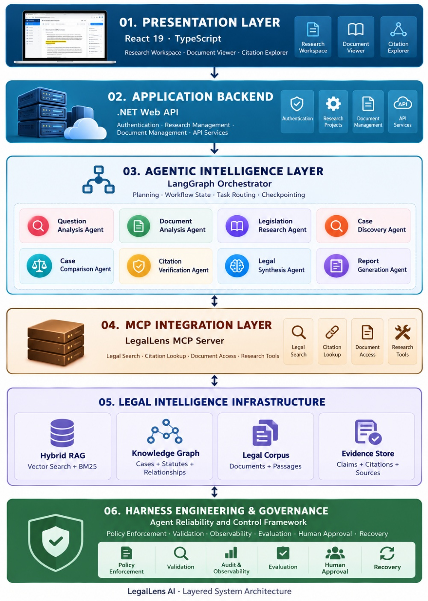
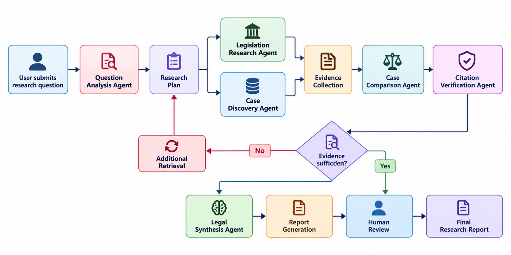
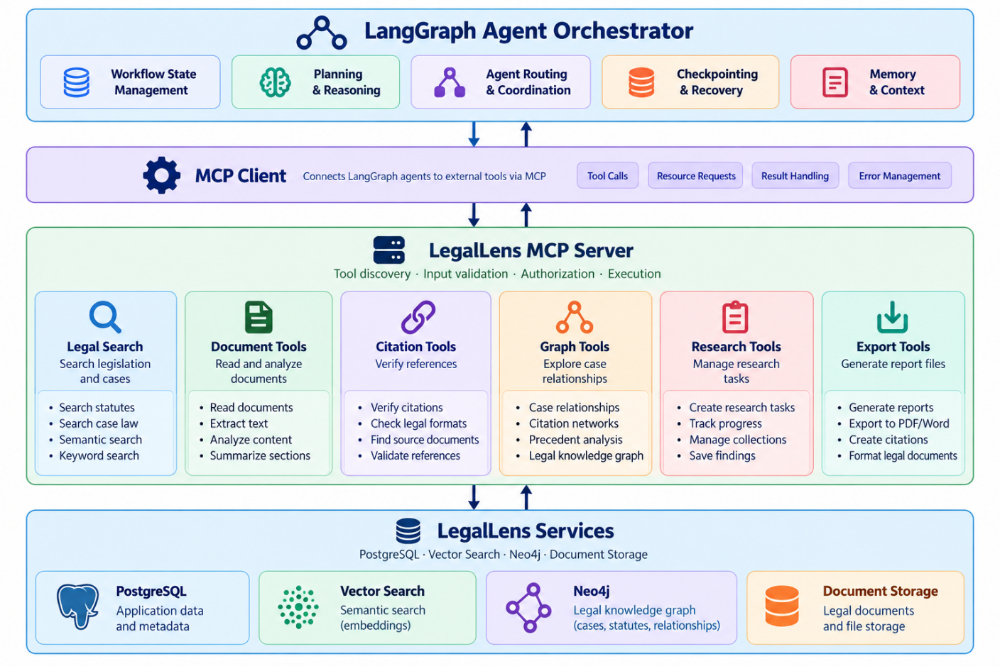
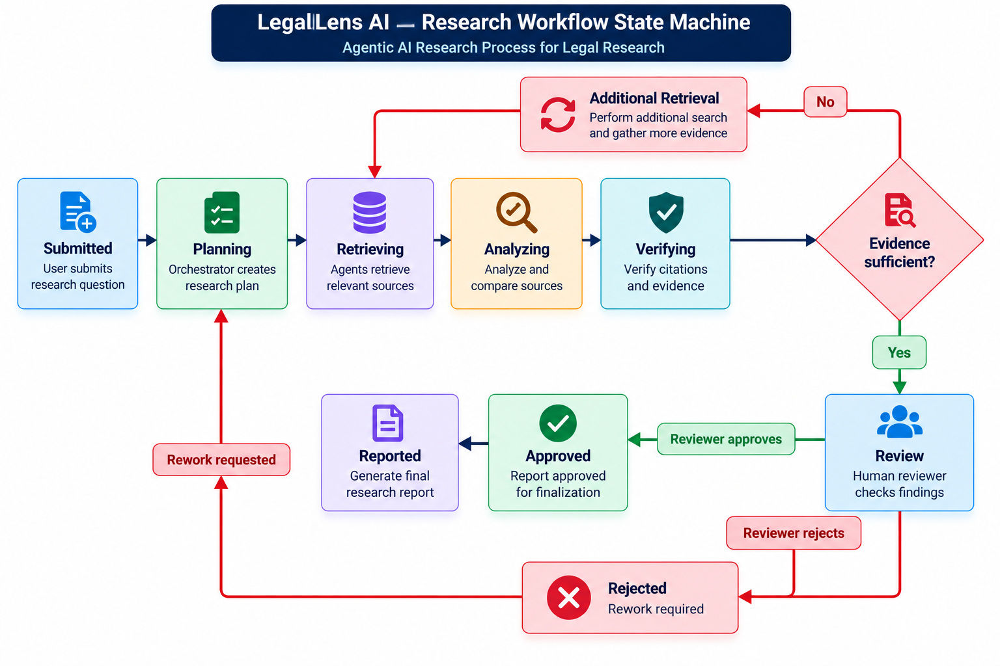
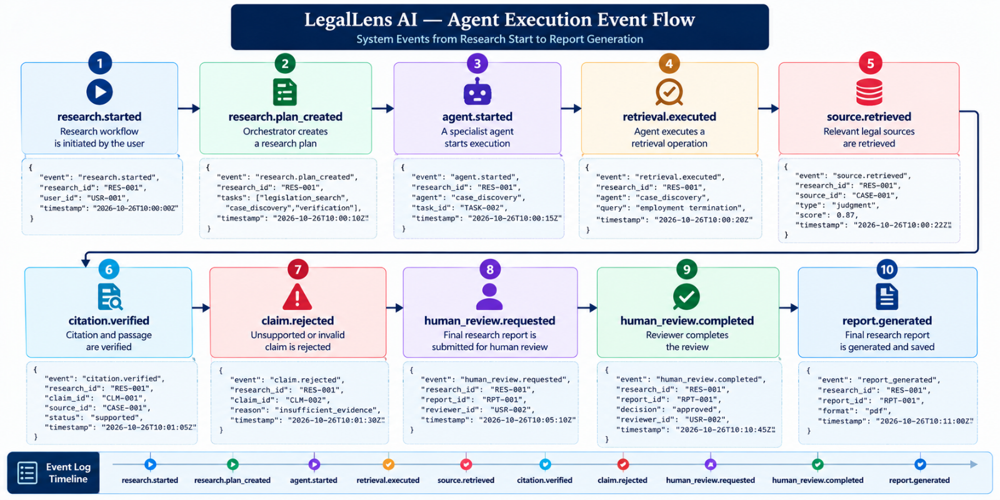
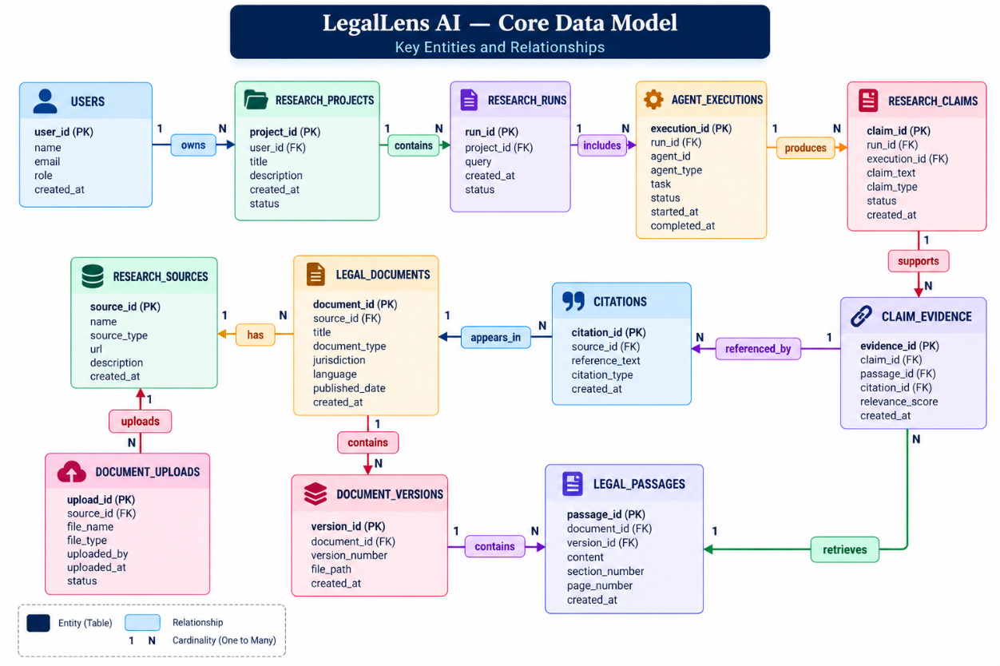

# LegalLens AI

**An Evidence-Grounded Agentic AI Platform for Sri Lankan Legal Research, Case Analysis and Citation Verification**

## PROJECT PROPOSAL REPORT

**Prepared by:** Mohamed Shakir  
**Date:** 30 October 2026

---

_An Evidence-Grounded Agentic AI Platform for Sri Lankan Legal Research,
Case Analysis and Citation Verification_

**LegalLens AI**

An Evidence-Grounded Agentic AI Platform for Sri Lankan Legal Research, Case Analysis and Citation Verification

Advanced portfolio project

Agentic AI + RAG + MCP

Harness Engineering

# 1. Executive summary

Legal research is a complex information-intensive process. Legal professionals, researchers and law students must examine legislation, judicial decisions, regulations and legal documents to understand how the law applies to a particular set of facts.

Although Large Language Models (LLMs) can explain legal concepts and summarize documents, relying on them for legal research introduces serious challenges:

- Legal hallucinations: generating nonexistent or inaccurate cases.

- Citation inaccuracies: referencing genuine judgments that do not support the generated claims.

- Jurisdiction confusion: applying foreign legal principles to Sri Lankan legal questions.

- Temporal inaccuracies: using outdated legislation or overlooking amendments.

- Fragmented information: legal sources are distributed across different repositories.

- Weak traceability: users cannot easily establish where a generated conclusion originated.

LegalLens AI proposes an evidence-grounded multi-agent research platform that combines:

- Agentic AI for autonomous research planning and coordinated investigation.

- Hybrid RAG for retrieving legislation, judgments and legal documents.

- Model Context Protocol (MCP) for standardized integration with legal research tools and external services.

- Knowledge Graphs for identifying relationships between cases, statutes, legal provisions and judicial references.

- Harness Engineering for controlling agent execution, enforcing permissions, verifying outputs and measuring reliability.

- Human-in-the-Loop for professional oversight of important findings.

The platform will allow users to ask legal research questions, upload documents, discover relevant cases, compare judicial decisions and generate research reports with traceable evidence.

The central engineering principle: LegalLens AI must be able to demonstrate why it produced an answer, which sources support it and whether those sources have been verified.

# 2. Project identity

Table 1. 2. Project identity2. Project identity2. Project identity

| Item | Description |
| --- | --- |
| Project name | LegalLens AI |
| Project category | Agentic AI / LegalTech |
| Domain | Legal research and document intelligence |
| Initial jurisdiction | Sri Lanka |
| Target users | Law students, legal researchers, lawyers and academics |
| Application type | Web-based intelligent research platform |
| AI architecture | Multi-agent orchestration |
| Knowledge architecture | Hybrid RAG + Knowledge Graph |
| Integration architecture | MCP |
| Reliability architecture | Harness Engineering |
| Development duration | 8 - 2 weeks |
| Deliverable | Deployed, demonstrable working prototype |

## Proposed project positioning

LegalLens AI is not intended to be another legal chatbot.

It is an AI-assisted legal research environment that performs structured investigations.

A chatbot answers a question.

LegalLens AI should:

- Understand the research problem.

- Develop a research plan.

- Find authoritative legal sources.

- Retrieve supporting passages.

- Compare relevant judicial decisions.

- Verify citations.

- Identify conflicting evidence and uncertainty.

- Produce a traceable research report.

That distinction should be visible in your implementation and final demonstration.

# 3. Problem statement

Sri Lankan legal information is distributed across legislation, official publications, judicial decisions and other legal resources.

Legal researchers must identify relevant sources, interpret legal terminology, locate previous judgments, compare judicial reasoning and verify legal citations.

This process can be time-consuming and requires careful attention to jurisdiction, legal authority and the validity of legal sources.

General-purpose LLMs can assist with natural-language explanations, but they are not inherently reliable legal research systems. They may generate unsupported legal statements, misrepresent judicial decisions or overlook legislative amendments.

There is therefore an engineering opportunity to develop an integrated AI-assisted legal research system that combines structured legal retrieval, coordinated agent-based investigation, source verification and controlled execution.

## Proposed problem statement:

How can a multi-agent AI architecture integrating hybrid Retrieval-Augmented Generation, legal knowledge graphs, Model Context Protocol and Harness Engineering improve the traceability, retrieval quality and reliability of legal research within the Sri Lankan legal context?

This gives the project a technical direction that can be evaluated rather than simply claiming that AI makes legal research faster.

# 4. Project aim and objectives

## 4.1 Main aim

To design and develop an evidence-grounded, multi-agent AI platform that assists users in conducting Sri Lankan legal research through intelligent document retrieval, legal case analysis, citation verification and structured research report generation.

## 4.2 Specific objectives

Table 2. 4.2 Specific objectives4.2 Specific objectives4.2 Specific objectives

| ID | Objective |
| --- | --- |
| RO1 | Develop a curated knowledge base of Sri Lankan legislation, judgments and legal documents. |
| RO2 | Implement a hybrid RAG pipeline combining semantic and keyword retrieval. |
| RO3 | Develop specialized AI agents for legal question analysis, legislation retrieval, case discovery and document analysis. |
| RO4 | Implement automated citation and evidence verification. |
| RO5 | Develop a legal knowledge graph representing relationships between cases and legislation. |
| RO6 | Implement an MCP server exposing controlled legal research tools. |
| RO7 | Implement Harness Engineering mechanisms for execution control, validation, observability and recovery. |
| RO8 | Evaluate the system using retrieval benchmarks, citation verification tests and comparative experiments. |

# 4. Scope and functional requirements

Sri Lankan employment law research and document analysis.

Why?

- It provides a bounded research domain.

- It supports meaningful statutory and case-law retrieval.

- It gives you realistic document-analysis use cases.

- It allows you to build a smaller but carefully validated corpus.

- It avoids the complexity of indexing every area of Sri Lankan law.

Corpus availability should be confirmed before this domain is finalized.

## 7.1 Functional requirements

Table 3. 7.1 Functional requirements7.1 Functional requirements7.1 Functional requirements

| ID | Requirement |
| --- | --- |
| FR-01 | Users can register, authenticate and manage research projects. |
| FR-02 | Users can submit legal research questions. |
| FR-03 | The system identifies the jurisdiction and legal domain. |
| FR-04 | Users can upload legal documents. |
| FR-05 | The system extracts text and structured document metadata. |
| FR-06 | The system retrieves relevant legislation. |
| FR-07 | The system retrieves relevant judgments. |
| FR-08 | The system performs hybrid legal retrieval. |
| FR-09 | The system compares selected judgments. |
| FR-10 | The system verifies case citations and statutory references. |
| FR-11 | The system maps claims to supporting passages. |
| FR-12 | The system generates structured research reports. |
| FR-13 | Users can inspect original source passages. |
| FR-14 | The system records research activity and agent execution traces. |
| FR-15 | Users can export research reports. |

## 7.2 Non-functional requirements

- Security and privacy of uploaded documents.

- Role-based access control.

- Source traceability.

- Reproducible research workflows.

- Low hallucination rates.

- Fault-tolerant execution.

- Document processing reliability.

- Scalable retrieval.

- Clear separation of legal information and professional legal advice.

# 8. Complete system architecture

The project team recommends a modular architecture with four major layers:

- Application layer.

- Agent orchestration layer.

- Legal intelligence layer.

- Harness and governance layer.

**LegalLens AI ****-**** System architecture**

Figure 1. LegalLens AI - System architectureLegalLensLegalLens AI  AI -- System architecture System architecture

## 8.1 Main service responsibilities

Table 4. 8.1 Main service responsibilities8.1 Main service responsibilities8.1 Main service responsibilities

| Service | Responsibility |
| --- | --- |
| Web application | Research interaction and evidence visualization |
| .NET backend | Core business logic and API |
| AI service | Agent orchestration |
| Retrieval service | Hybrid search and re-ranking |
| Ingestion service | Legal document processing |
| MCP server | Controlled external tool access |
| Verification service | Citation and evidence checking |
| Background workers | Document processing and long-running tasks |
| Database | Persistent application and research records |

## 8.2 Example end-to-end workflow

A user asks:

"Research the legal framework applicable to termination of employment in Sri Lanka and identify relevant judicial decisions."

The following workflow takes place:

Figure 2. The following workflow takes place:The following workflow takes place:The following workflow takes place

The system must retain the retrieved passages and intermediate findings so that the final report is reproducible.

# 9. Detailed agent design

This is the heart of the system.

The project team recommends eight specialized agents, with one orchestrator.

The proposed implementation will use eight task-specific components within one controlled workflow rather than eight independent chatbots.

## 9.1 Research Orchestrator Agent

Central coordinator

Responsibility: Coordinate the complete research process.

Inputs:

- User research question.

- Jurisdiction.

- Legal domain.

- Uploaded documents.

- User research preferences.

Operations:

- Analyze the requested task.

- Generate a research plan.

- Determine which specialist agents are required.

- Dispatch tasks.

- Collect structured findings.

- Detect incomplete evidence.

- Request additional investigation.

- Trigger final synthesis.

- Persist workflow state.

Example output:

{

"research_id": "RES-001",

"jurisdiction": "LK",

"domain": "Employment Law",

"tasks": [

"identify_relevant_legislation",

"discover_relevant_judgments",

"analyze_uploaded_documents",

"verify_citations"

],

"requires_human_review": true

}

## 9.2 Question Analysis Agent

Responsibility: Understand what the user actually wants to investigate.

It extracts:

- Legal domain.

- Jurisdiction.

- Relevant parties.

- Key facts.

- Important dates.

- Legal questions.

- Research scope.

- Missing information.

Example:

Input:

"Can an employer terminate an employee without following the applicable legal procedure?"

Output:

- Domain: Employment law.

- Jurisdiction: Sri Lanka.

- Research issue: Employment termination.

- Research objective: Identify applicable statutory requirements and relevant judgments.

- Missing context: Employment type, relevant dates, applicable agreement and other facts.

The agent must not invent missing facts.

## 9.3 Document Analysis Agent

Responsibility: Extract structured information from uploaded documents.

Supported documents:

- PDF.

- DOCX.

- TXT.

Operations:

- Extract document text.

- Identify document type.

- Extract parties.

- Extract dates.

- Identify relevant clauses.

- Identify references to statutes and cases.

- Highlight potentially relevant provisions.

- Produce structured extraction results.

Important: The agent should distinguish text extracted directly from the document from interpretations generated by an LLM.

## 9.4 Legislation Research Agent

Responsibility: Find relevant legislation and statutory provisions.

Operations:

- Identify the legal subject.

- Search the legislation corpus.

- Apply jurisdiction and temporal filters.

- Retrieve relevant Acts and provisions.

- Identify amendments and effective dates where available.

- Return exact source passages.

Example output:

{

"source_type": "legislation",

"document_id": "ACT-001",

"title": "Verified Act title",

"section": "Section reference",

"relevant_passage_ids": [

"PASSAGE-101"

],

"source_status": "verified"

}

The title and section above are placeholders, not actual legal references.

## 9.5 Case Discovery Agent

Responsibility: Find relevant Sri Lankan judgments.

Retrieval methods:

- Semantic search.

- Keyword search.

- Citation search.

- Metadata search.

- Graph traversal.

The agent should identify:

- Case name.

- Court.

- Case number.

- Date.

- Relevant passages.

- Cited legislation.

- Related cases.

It should distinguish a judgment's existence from its legal relevance.

## 9.6 Case Comparison Agent

Responsibility: Compare relevant judgments.

A useful comparison structure:

Table 5. A useful comparison structure:A useful comparison structure:A useful comparison structure

| Dimension | Case A | Case B |
| --- | --- | --- |
| Facts | Extracted facts | Extracted facts |
| Legal issue | Identified issue | Identified issue |
| Applicable law | Verified provisions | Verified provisions |
| Judicial reasoning | Relevant passages | Relevant passages |
| Outcome | Verified outcome | Verified outcome |
| Distinction | Comparison | Comparison |

The agent should not automatically classify a case as binding or persuasive without considering the relevant court hierarchy, jurisdiction and procedural context.

## 9.7 Citation Verification Agent

Signature component

Responsibility: Verify the legal references and evidence supporting generated claims.

It performs:

- Case existence checks.

- Case metadata checks.

- Statutory citation checks.

- Passage existence checks.

- Claim-to-evidence support checks.

- Contradiction detection.

- Source-version checks.

Suggested output:

{

"claim_id": "CLM-001",

"source_id": "CASE-001",

"passage_id": "PASSAGE-101",

"source_verified": true,

"passage_verified": true,

"support_status": "supported",

"jurisdiction_match": true,

"review_required": false

}

A failed verification should not be silently ignored. The orchestrator should remove, qualify or investigate the unsupported claim.

## 9.8 Legal Synthesis Agent

Responsibility: Combine the findings from specialist agents.

It produces:

- Research summary.

- Relevant statutory provisions.

- Relevant judicial decisions.

- Legal principles identified in sources.

- Similarities and differences between cases.

- Potentially conflicting authorities.

- Factual uncertainties.

- Research limitations.

This agent should synthesize evidence, not act as a substitute for a qualified lawyer's legal opinion.

## 9.9 Report Generation Agent

Responsibility: Produce the final structured report.

Recommended report:

- Executive summary.

- Research question.

- Jurisdiction and scope.

- Facts provided by the user.

- Identified legal issues.

- Relevant legislation.

- Relevant judgments.

- Case comparison.

- Evidence-backed findings.

- Uncertainties and limitations.

- Source bibliography.

Every legal claim should retain a link to its evidence record.

# 10. RAG pipeline — Detailed engineering design

This is where you can demonstrate genuine AI engineering.

A basic RAG pipeline is insufficient for LegalLens.

The project team recommends a Structure-Aware Hybrid Legal RAG Pipeline.

## 10.1 Data ingestion

Input sources:

- Acts.

- Amendment Acts.

- Regulations.

- Gazette documents.

- Court judgments.

- Legal research documents.

The ingestion pipeline should capture the following metadata:

{

"document_id": "DOC-001",

"document_type": "judgment",

"jurisdiction": "LK",

"court": "Supreme Court",

"case_number": "source-derived",

"document_title": "source-derived",

"publication_date": "source-derived",

"effective_date": null,

"source_url": "original-source",

"language": "en",

"verification_status": "pending"

}

Use source-derived values only. Missing fields should remain null.

## 10.2 Document preprocessing

Legal documents require special treatment.

A normal text splitter may break legal sections incorrectly.

For example:

Section 10

Subsection (1)

Paragraph (a)

Paragraph (b)

These parts may need to remain together because their legal meaning depends on their hierarchy.

Recommended preprocessing:

- PDF text extraction.

- OCR for scanned documents.

- Heading detection.

- Section and subsection extraction.

- Paragraph identification.

- Table extraction.

- Metadata extraction.

- Document integrity checks.

Store the original document and its extracted representation.

## 10.3 Structure-aware chunking

Instead of arbitrary 500-token chunks, use legal document structure.

Recommended chunk types:

Table 6. Recommended chunk types:Recommended chunk types:Recommended chunk types

| Document | Chunking strategy |
| --- | --- |
| Legislation | Act → Part → Section → Subsection |
| Judgments | Case → Headnote/metadata → Paragraph |
| Contracts | Clause → Subclause → Paragraph |
| Regulations | Regulation → Subregulation |
| Research papers | Heading → Section → Paragraph |

Preserve the original page and paragraph references.

Each chunk should contain:

- Document ID.

- Passage ID.

- Original text.

- Page number.

- Section or paragraph.

- Jurisdiction.

- Document type.

- Publication date.

- Legal version information.

- Source URL.

## 10.4 Embedding generation

Generate embeddings for each legal passage.

Possible models:

- OpenAI embedding models.

- BGE embedding models.

- Multilingual embedding models.

For the initial English-language MVP, benchmark two embedding models rather than automatically choosing the largest one.

## 10.5 Hybrid retrieval

**Hybrid legal retrieval**

Research query

Vector Search

Semantic similarity

BM25 Search

Exact terminology

Metadata filtering

Sri Lanka · Court · Date · Document type

Reciprocal Rank Fusion

Combine retrieval rankings

Cross-encoder / semantic re-ranking

Verified relevant passages

Why hybrid retrieval?

Consider the query:

"Find judgments discussing termination of employment."

Semantic search may identify documents discussing dismissal, termination and employment disputes.

Keyword search can identify exact statutory phrases and case references.

Combining both can improve retrieval coverage.

Use Reciprocal Rank Fusion (RRF) to combine rankings, followed by re-ranking.

## 10.6 Knowledge graph retrieval

Create a legal knowledge graph using Neo4j.

Proposed entities:

- Case.

- Court.

- Judge.

- Act.

- Section.

- Regulation.

- Legal concept.

- Party.

- Document.

Proposed relationships:

- CITES

- INTERPRETS

- APPLIES

- AMENDS

- DISTINGUISHES

- OVERRULES

- HEARD_BY

- CONTAINS_SECTION

Only establish relationships when they are supported by reliable source evidence. In particular, OVERRULES must not be inferred from mere citation patterns.

Example:

**Legal knowledge graph example**

Case A

Judgment

CITES ↓

Case B

Earlier judgment

INTERPRETS ↓

Act C — Section 12

Statutory provision

Illustrative graph structure; the entities and relationships must come from actual legal sources.

## 10.7 Retrieval and synthesis

The final context supplied to the Legal Synthesis Agent should include:

- Relevant passages.

- Source metadata.

- Retrieval scores.

- Jurisdiction.

- Legal document dates.

- Citation relationships.

- Verification status.

The agent should not receive only raw text. It should receive evidence objects that retain source identity.

## 10.8 Source-grounded generation

Use a strict generation contract:

- Do not invent legal authorities.

- Do not invent quotations.

- Do not invent paragraph numbers.

- Do not mix jurisdictions.

- Distinguish verified facts from inferred interpretations.

- Cite the supporting passage for each important claim.

- State when evidence is insufficient.

- Preserve uncertainty and conflicting sources.

A key design rule: If the system cannot find adequate supporting evidence, it must return an insufficient-evidence response instead of fabricating an answer.

# 11. MCP architecture and tool integration

MCP will be an important architectural component, not just a technology mentioned in the project documentation.

Your application will implement a custom LegalLens MCP Server.

This server exposes legal research capabilities to the AI agents through standardized tools.

## 11.1 MCP architecture

**LegalLens MCP architecture**

Figure 3. LegalLens MCP architectureLegalLensLegalLens MCP architecture MCP architecture

## 11.2 Proposed MCP tools

## Legal retrieval tools

Table 7. Legal retrieval toolsLegal retrieval toolsLegal retrieval tools

| Tool | Purpose |
| --- | --- |
| search_legislation | Search legislation by topic or keywords |
| get_legislation_section | Retrieve a particular statutory provision |
| search_judgments | Search Sri Lankan judgments |
| get_judgment_details | Retrieve judgment metadata and content |
| search_legal_concepts | Search indexed legal concepts |
| get_related_cases | Discover connected cases |

## Citation and verification tools

Table 8. Citation and verification toolsCitation and verification toolsCitation and verification tools

| Tool | Purpose |
| --- | --- |
| verify_case_citation | Verify a case citation |
| verify_statutory_reference | Verify an Act and section |
| verify_evidence_passage | Confirm that a supporting passage exists |
| check_claim_support | Assess whether a passage supports a claim |

## Document and research tools

Table 9. Document and research toolsDocument and research toolsDocument and research tools

| Tool | Purpose |
| --- | --- |
| get_uploaded_document | Retrieve an authorized uploaded document |
| extract_document_clauses | Extract document clauses |
| create_research_record | Create a research record |
| get_research_history | Retrieve previous research activity |
| export_research_report | Export an approved report |

## 11.3 MCP security design

Do not give every agent access to every tool.

For example:

Table 10. For example:For example:For example

| Agent | Allowed MCP tools |
| --- | --- |
| Legislation Agent | Legislation search and section retrieval |
| Case Discovery Agent | Judgment search and related cases |
| Citation Agent | Citation and evidence verification |
| Document Agent | Authorized document retrieval |

Important controls:

- Validate all tool inputs.

- Enforce user-level document permissions.

- Apply tool-specific permissions.

- Restrict database queries.

- Set execution timeouts.

- Log every invocation.

- Treat retrieved documents as untrusted data.

- Never execute instructions found inside uploaded legal documents.

- Keep secrets and credentials outside LLM context.

MCP standardizes the tool interface. Your backend must still enforce the security policies.

Official protocol reference: .

# 12. Harness Engineering - Reliability and control infrastructure

Major engineering differentiator

This component warrants particular attention.

A multi-agent application can fail in many ways:

- An agent invents a case citation.

- An agent repeatedly calls the same tool.

- An agent retrieves irrelevant documents.

- An agent enters an infinite research loop.

- An agent receives malicious instructions from an uploaded document.

- An agent produces malformed JSON.

- An agent reports that a citation is verified without checking the original source.

Harness Engineering is the system surrounding your agents that controls, monitors, tests and constrains their behavior.

## 12.1 Proposed harness components

Table 11. 12.1 Proposed harness components12.1 Proposed harness components12.1 Proposed harness components

| Component | Implementation |
| --- | --- |
| Workflow controller | LangGraph state machine |
| State persistence | PostgreSQL checkpointer |
| Input validation | Pydantic schemas |
| Output validation | JSON Schema / Pydantic |
| Tool permissions | Role-based tool registry |
| Execution limits | Maximum iterations and token budgets |
| Timeout handling | Per-agent execution timeouts |
| Retry mechanism | Bounded retries with backoff |
| Evidence validation | Citation verification service |
| Observability | Structured logs and OpenTelemetry |
| Evaluation | Automated benchmark pipeline |
| Human review | Workflow interruption and approval |
| Security | Prompt-injection defenses and data isolation |

## 12.2 Agent execution contract

Every agent must follow a defined execution contract.

For example:

{

"agent_name": "case_discovery_agent",

"task_id": "TASK-001",

"status": "completed",

"findings": [],

"source_ids": [],

"passage_ids": [],

"confidence": 0.89,

"limitations": [],

"requires_human_review": false

}

The confidence value is illustrative. Do not treat an LLM's self-reported confidence as a calibrated probability.

## 12.3 Workflow state machine

Figure 4. 12.3 Workflow state machine12.3 Workflow state machine12.3 Workflow state machine

This avoids uncontrolled agent loops.

## 12.4 Human-in-the-loop design

For your prototype, human approval should be required for:

- Approving a final research report.

- Exporting a report marked for professional review.

- Sharing private uploaded documents.

- Publishing or distributing research results.

The system can autonomously search, retrieve, compare and prepare reports, but sensitive actions remain controlled.

## 12.5 Reliability mechanisms

The project team recommends implementing these five particularly important mechanisms.

### 1. Evidence gate

No important legal claim enters the final report without an evidence record or an explicit unsupported/uncertain label.

### 2. Citation gate

A citation cannot be marked verified merely because an LLM says it is correct. It must be checked against an indexed or accessible source.

### 3. Retrieval sufficiency gate

If the required evidence is missing, the workflow performs bounded additional retrieval or reports insufficient evidence.

### 4. Execution budget

Example initial limits:

Table 12. Example initial limits:Example initial limits:Example initial limits

| Control | Suggested MVP limit |
| --- | --- |
| Specialist agent iterations | 3 |
| Research retrieval rounds | 3 |
| Tools per research task | 20 |
| Agent execution timeout | 60 seconds |
| Workflow total timeout | 10 minutes |
| Automatic retry attempts | 2 |

These are starting configuration values, not established optimal limits.

### 5. Recovery

If the application restarts during research, the system should resume from the saved workflow checkpoint rather than restarting every agent.

LangGraph supports persistent state and human-in-the-loop workflow patterns. See  and .

## 12.6 Agent observability

Record every important event:

Figure 5. Record every important event:Record every important event:Record every important event

This makes it possible to investigate why a particular answer was produced.

Recommended observability tools:

- OpenTelemetry.

- Langfuse.

- Structured application logs.

- PostgreSQL execution records.

Do not log confidential document contents or personal information unnecessarily.

# 13. Dataset Strategy and Knowledge Base Development

## 13.1 Dataset Approach

For the initial Minimum Viable Product (MVP), LegalLens AI will use a **synthetic, AI-augmented legal research dataset** generated with the assistance of ChatGPT. This approach is intended to establish and demonstrate the platform's core technical capabilities without depending on the immediate availability, accessibility, or licensing of real Sri Lankan legal documents.

The synthetic dataset will simulate the structure and relationships found in legal research materials, including legislation extracts, judicial decisions, legal concepts, case references, and research questions. The generated content will be organized around the initial target domain of Sri Lankan employment law.

The dataset will support the development and testing of the platform's primary capabilities:

- Legal document ingestion and processing.

- Structure-aware document chunking and metadata extraction.

- Hybrid Retrieval-Augmented Generation (RAG).

- Semantic and keyword-based legal information retrieval.

- Multi-agent legal research and orchestration.

- Citation and evidence verification workflows.

- Legal knowledge graph construction.

- Research report generation and evidence traceability.

**Important distinction:** The synthetic documents will be simulated examples, not authentic Sri Lankan legislation, court judgments, or legal authorities. They will not be presented as genuine legal sources or used to make claims about actual Sri Lankan law.

## 13.2 Synthetic Dataset Composition

The initial dataset will focus on employment-related legal research scenarios and contain the following categories:

Table 13. Project data

| Dataset component | Proposed initial target | Purpose |
| --- | --- | --- |
| Synthetic legislation documents | 15–20 | Simulate Acts, sections and statutory provisions |
| Synthetic judicial decisions | 30–50 | Simulate case facts, judicial reasoning and decisions |
| Legal research documents | 10–15 | Provide contextual legal research material |
| Sample employment contracts | 10–15 | Support document analysis and clause extraction |
| Research questions | 50–100 | Test natural-language legal research queries |
| Claim-evidence verification examples | 50–100 | Evaluate citation and evidence verification |

These figures represent proposed MVP dataset targets rather than existing or collected legal materials.

## 13.3 Synthetic Data Generation and Preparation

ChatGPT will be used as an AI-assisted data generation tool to create structured, internally consistent legal research examples.

The preparation process will follow these stages:

- **Define the dataset schema:** Establish standardized structures for legislation, judgments, legal documents, passages, citations and research questions.

- **Generate synthetic documents:** Create representative employment-law scenarios, simulated statutory provisions, fictional judicial decisions and sample contracts.

- **Generate document metadata:** Assign unique document identifiers, document types, jurisdiction labels, dates, section numbers and other relevant metadata.

- **Establish relationships:** Create controlled references between synthetic cases, statutory provisions, legal concepts and supporting passages.

- **Generate research questions:** Develop questions that require different retrieval, comparison and evidence-verification operations.

- **Validate generated content:** Check structural consistency, metadata completeness, passage references and relationships before ingestion.

- **Prepare benchmark examples:** Associate selected research questions with expected document IDs, relevant passages and expected answer points.

Every generated document will be explicitly identified as synthetic. Generated citations and case references will use internal identifiers rather than being represented as genuine legal citations.

## 13.4 Dataset Authenticity and Limitations

Since the initial dataset is AI-generated, it cannot establish the legal accuracy or real-world applicability of the platform's research outputs.

The MVP evaluation will therefore focus on technical capabilities, including:

- Whether relevant documents and passages can be retrieved.

- Whether agents can coordinate research tasks successfully.

- Whether relationships between documents can be identified.

- Whether citations can be checked against the indexed synthetic sources.

- Whether generated claims are supported by their associated passages.

- Whether the system can identify missing or insufficient evidence.

- Whether research reports maintain traceability to their underlying sources.

The system will not claim to verify real-world legal authority during this development stage. Citation verification will demonstrate source existence, passage existence and claim-to-source support within the synthetic dataset.

All MVP research results will be clearly labelled as demonstrations based on synthetic data and must not be relied upon as legal advice or authoritative interpretations of Sri Lankan law.

## 13.5 Future Integration of Authentic Sri Lankan Legal Documents

The proposed dataset strategy is designed to support future expansion without requiring a fundamental redesign of the system architecture.

Following the MVP, the synthetic dataset can progressively be supplemented with or replaced by authentic Sri Lankan legal materials, subject to source verification, access permissions, licensing and reuse requirements.

Potential sources to investigate include:

- Parliament of Sri Lanka – legislation and parliamentary materials.

- LawNet Sri Lanka – legal research materials.

- Supreme Court of Sri Lanka – judicial decisions.

- Court of Appeal of Sri Lanka – judicial decisions.

- Department of Government Printing – official Gazette publications.

The future integration process will include source authenticity checks, document extraction, OCR where necessary, metadata validation, structure-aware chunking, embedding generation, indexing and knowledge graph construction.

The existing ingestion pipeline will be designed to accept new documents independently of the original synthetic dataset. Each document will retain its source information, document type, version, jurisdiction and authenticity status.

This will allow LegalLens AI to transition from a controlled synthetic research environment into a more comprehensive Sri Lankan legal research platform as authentic legal materials become available.

## 13.6 Dataset Extensibility

To support this transition, the system will distinguish between synthetic and authentic documents through explicit metadata.

Table 14. Project data

| Metadata field | Description |
| --- | --- |
| document_id | Unique document identifier |
| document_type | Legislation, judgment, contract or research document |
| jurisdiction | Jurisdiction associated with the document |
| source_type | Synthetic or official/external source |
| is_synthetic | Identifies AI-generated demonstration content |
| source_url | Original document URL, where applicable |
| document_version | Document version or revision |
| created_at | Dataset creation or ingestion timestamp |
| verification_status | Document authenticity and validation status |

This separation will ensure that synthetic demonstration content cannot be confused with authentic legal authorities when the platform is expanded.

**Overall, the synthetic dataset provides a controlled and cost-effective foundation for developing and evaluating the LegalLens AI MVP, while the extensible ingestion architecture establishes a clear pathway towards integrating authentic Sri Lankan legal documents in future development stages.**

# 14. Database design

The project team recommends PostgreSQL as your primary database.

The proposed design uses separate storage systems for distinct responsibilities.

Table 15. Project data

| Technology | Responsibility |
| --- | --- |
| PostgreSQL | Users, research projects, documents, citations and audit data |
| Pinecone | Vector embeddings |
| Neo4j | Legal relationship graph |
| Redis | Caching and background job coordination |
| Cloudinary | Original PDFs and uploaded files |

For a limited MVP budget, PostgreSQL with pgvector and full-text search can replace a separate vector database initially. Add Pinecone or Neo4j only when they materially improve the system.

## 14.1 Entity relationship model

Figure 6. 14.1 Entity relationship model14.1 Entity relationship model14.1 Entity relationship model

## 14.2 Main tables

Table 16. 14.2 Main tables14.2 Main tables14.2 Main tables

| Table | Important columns |
| --- | --- |
| Users | Id, Email, PasswordHash, Role |
| ResearchProjects | Id, UserId, Title, Domain |
| ResearchRuns | Id, ProjectId, Question, Status |
| LegalDocuments | Id, Title, Type, Jurisdiction, SourceUrl |
| DocumentVersions | Id, DocumentId, Version, EffectiveDate |
| LegalPassages | Id, DocumentId, Section, Paragraph, Content |
| Citations | Id, SourceDocumentId, TargetDocumentId, Type |
| ResearchSources | Id, ResearchRunId, DocumentId, RetrievalRank |
| ResearchClaims | Id, ResearchRunId, ClaimText, Status |
| ClaimEvidence | Id, ClaimId, PassageId, SupportStatus |
| AgentExecutions | Id, ResearchRunId, AgentName, Status |
| AgentEvents | Id, ExecutionId, EventType, Timestamp |
| DocumentUploads | Id, UserId, StorageKey, ProcessingStatus |
| HumanReviews | Id, ResearchRunId, ReviewerId, Decision |
| AuditLogs | Id, UserId, Action, Timestamp |

## 14.3 Important database design decisions

Document versioning

An existing legislative document should not be overwritten by a newer version.

Maintain different versions with their respective effective dates and source information.

Passage provenance

Every indexed passage must retain the original document, page and paragraph or section.

Claim evidence

Store the relationship between generated claims and source passages explicitly.

Research reproducibility

Store:

- Retrieval query.

- Retrieved source IDs.

- Model and prompt version.

- Agent execution sequence.

- Verification outcomes.

- Research completion time.

This allows you to investigate how a report was generated.

# 15. Recommended technology stack

**LegalLens technology stack**

Table 17. LegalLens technology stackLegalLensLegalLens technology stack technology stack

| Component | Technology | Responsibility |
| --- | --- | --- |
| Frontend | React 19 + TypeScript | Research workspace, document viewer and dashboards |
| Backend | .NET 10 Web API | Authentication, APIs and business logic |
| AI Services | Python | Agent orchestration, document processing and retrieval |
| Agent Framework | LangGraph | Stateful agent workflows and checkpoints |
| LLM | OpenAI API | Question understanding, research synthesis and verification |
| Database | PostgreSQL | Core application data, metadata and research history |
| Vector Database | pgvector / Pinecone | Semantic legal passage retrieval |
| Knowledge Graph | Neo4j | Citation and legal relationship exploration |
| Agent Integration | MCP Python SDK | Standardized agent tool access |
| Deployment | Docker | Containerized services and reproducible setup |

## Additional libraries

Table 18. Additional librariesAdditional librariesAdditional libraries

| Requirement | Suggested library |
| --- | --- |
| PDF extraction | PyMuPDF |
| OCR | Tesseract |
| Document parsing | python-docx |
| Validation | Pydantic |
| API framework for AI service | FastAPI |
| Keyword retrieval | PostgreSQL FTS / BM25 |
| Re-ranking | Cross-encoder |
| Embeddings | OpenAI / BGE |
| Graph access | Neo4j Python driver |
| Background jobs | Celery / Redis |
| Tracing | OpenTelemetry + Langfuse |
| Backend testing | xUnit |
| AI testing | pytest |
| Frontend testing | Vitest + React Testing Library |

# 17. Evaluation methodology

LegalLens AI should not be evaluated solely on whether its answers appear intelligent.

The evaluation should be supported by measurable evidence.

The project team recommends five evaluation dimensions.

## 17.1 Retrieval evaluation

Measure whether the system retrieves the correct legal passages.

Metrics:

Table 19. Metrics:Metrics:Metrics

| Metric | Purpose |
| --- | --- |
| Precision@K | Proportion of retrieved passages that are relevant |
| Recall@K | Proportion of relevant passages successfully retrieved |
| MRR | Ranking quality of the first relevant passage |
| nDCG@K | Ranking quality considering graded relevance |

Example:

Suppose the expected supporting passages are:

P1, P2, P3, P4

The system retrieves:

P1, P3, P5, P6

Then:

\\[ Precision@4 = \\frac{2}{4}=0.5 \\]

\\[ Recall@4 = \\frac{2}{4}=0.5 \\]

This makes retrieval performance objectively measurable.

## 17.2 Citation verification evaluation

This should be a major evaluation area.

Measure:

- Citation existence accuracy.

- Citation metadata accuracy.

- Passage existence accuracy.

- Claim-to-source support precision.

- Unsupported claim detection.

- False acceptance rate.

Example:

Suppose the system generates 100 citations.

- 95 refer to real sources.

- 90 match the correct metadata.

- 85 have passages that genuinely support the corresponding claims.

You can separately report these three levels rather than combining them into one misleading accuracy score.

## 17.3 Answer quality evaluation

Use a human evaluation rubric, ideally reviewed by a legal academic or qualified legal professional.

Table 20. Project data

| Dimension | Evaluation |
| --- | --- |
| Legal relevance | Does the answer address the research question? |
| Source correctness | Are the cited sources valid? |
| Evidence support | Do sources support the claims? |
| Jurisdiction | Is the answer grounded in Sri Lankan law? |
| Completeness | Are important issues omitted? |
| Clarity | Is the explanation understandable? |
| Uncertainty | Are limitations appropriately disclosed? |

Use a 1–5 rating scale.

Do not use an LLM judge as the only evaluator for legal correctness.

## 17.4 Agent reliability evaluation

Measure:

- Task completion rate.

- Tool invocation success rate.

- Invalid tool-call rate.

- Average number of agent iterations.

- Workflow timeout rate.

- Recovery success rate.

- Human review rejection rate.

- Duplicate tool invocation rate.

## 17.5 Performance evaluation

Measure:

- Average research completion time.

- Retrieval latency.

- Embedding processing time.

- Token consumption.

- Cost per research task.

- Database query performance.

## Proposed project targets

These are development targets to aim for, not claimed results.

Table 21. Project data

| Metric | Initial target |
| --- | --- |
| Precision@5 | ≥ 0.80 |
| Recall@10 | ≥ 0.80 |
| Citation source verification | ≥ 95% |
| Unsupported claims correctly flagged | ≥ 90% |
| Invalid MCP tool calls | ≤ 2% |
| Successful workflow completion | ≥ 90% |
| Source traceability for material claims | 100% |

For citation verification, distinguish source existence from semantic support. A 95% source verification rate does not mean 95% legal correctness.

## 17.6 Evaluation dataset design

The project team recommends starting with 100 manually reviewed questions.

Divide them into:

Table 22. Divide them into:Divide them into:Divide them into

| Question category | Number |
| --- | --- |
| Direct statutory lookup | 20 |
| Legal concept research | 20 |
| Case discovery | 20 |
| Multi-case comparison | 15 |
| Document-based research | 15 |
| Citation verification | 10 |
| Total | 100 |

Have a legal-domain reviewer validate the gold sources and passages.

Keep a separate held-out test set so that prompt and retrieval tuning do not leak into the final evaluation.

**END**
